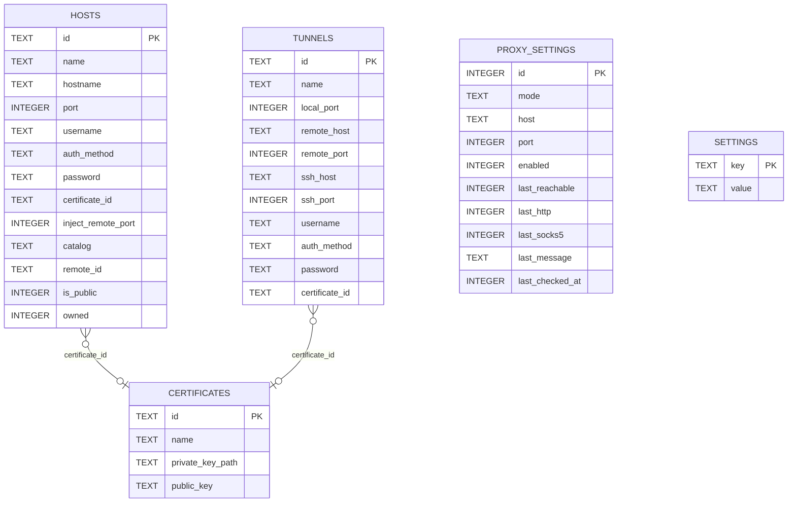
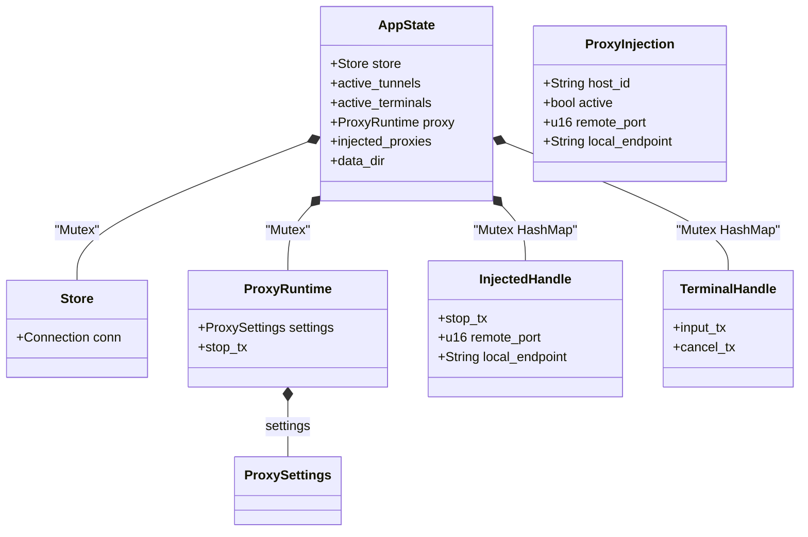

# Cangling Keeper

A browser-based local management service built with **Rust + Axum**, targeting
**Windows** and **Linux**. It manages remote hosts and exposes its interface on
the local loopback address.

## Features

- Define, edit, and delete SSH hosts (name, hostname/IP, port, username, password).
- Select a host and run a command over SSH, showing stdout/stderr/exit status.
- Define SSH local port-forward tunnels (`ssh -N -L ...`) — paste an SSH command
  to auto-fill the form, or fill the fields manually.
- Connect/disconnect tunnels; the list shows live connection state.
- Tunnel auth via password or an ed25519 key pair (generate one in-app).
- 软件仓库：缺省使用 HTTP 网盘目录 `cangling-repo`，内置只读连接配置，不需要 Git/LFS 或维护中心登录。递归同步支持 Range 断点续传、SHA-256 校验和已有内容复用，完整验证后切换资源快照；失败保留旧资源。升级时迁移原 cangling-repo Git 连接，保留本地文件直到新快照同步成功。手动配置的其他 Git/Manifest 同步能力保持兼容。
- 主机面板可将本地已拉取的软件同步到 Master 主机上 cangling-update 的 `repo/<软件集>/` 目录（按软件集名分目录，避免同名覆盖）。已存在且大小、SHA-256 都相同的文件会跳过，避免 `version.txt` 这类等长变更被漏传。
- 集群管理：SSH 探测该主机 cangling-update 的实际监听端口后，用主机地址 + 服务端口直接打开 `/console`（`install-service` 后端口变化也会跟上；探测不到时缺省 5400）。
- Hosts and tunnels persist to a SQLite database in the app data directory.

> **Security note (current state):** passwords are stored in plain text in the
> local SQLite database, and SSH host keys are not yet verified
> (trust-on-first-use is a planned improvement). Treat this as a local tool on a
> trusted machine for now.

## Data model

### SQLite schema

Stored in `<app_data_dir>/data.sql`. Authentication is denormalized per row
(`auth_method` + `password` + `certificate_id`); `certificate_id` is only set
when `auth_method = 'certificate'` and references `certificates.id` (a logical
foreign key, not enforced by SQLite). `hosts.remote_id` is the server-side host
id used for sync.



- `proxy_settings` is a singleton row (`id = 1`).
- `settings` is a generic key/value store (server URL, login token, username,
  nickname).

### Rust structs

Core domain and DTO structs (see `src/host.rs`, `src/auth.rs`,
`src/certificate.rs`, `src/tunnel.rs`, `src/proxy.rs`, `src/sync.rs`,
`src/host_actions.rs`, `src/ssh.rs`).


Enum variants carry data:

- `Auth::Password { password }`, `Auth::Certificate { certificate_id }`
- `ResolvedAuth::Password(String)`, `ResolvedAuth::Key(String)`

### Runtime state



- `AppState` is the shared server state; the maps and handles are guarded
  by `Mutex` and hold tokio `oneshot`/`mpsc` senders used to cancel active
  tunnels, terminals and proxy injections.

## Project structure

```
cangling-keeper/
├── Cargo.toml              # Rust crate and server dependencies
├── src/
│   ├── main.rs             # Entry point
│   ├── lib.rs              # Shared service state and business logic
│   ├── web.rs              # Axum HTTP/WebSocket server and API dispatcher
│   ├── host.rs             # Host model
│   ├── tunnel.rs           # Tunnel model + SSH command parsing
│   ├── store.rs            # SQLite persistence (hosts + tunnels)
│   ├── repo.rs             # 软件仓库：软件集 manifest 同步 + 目录/文件浏览
│   └── ssh.rs              # SSH exec, port forwarding, key generation (russh)
└── ui/                     # Frontend (plain HTML/CSS/JS, no bundler)
    ├── index.html
    ├── styles.css
    └── main.js
```

The frontend is dependency-free. It calls the Rust service through JSON APIs;
terminal output and long-task progress are delivered through WebSocket.

SSH is implemented with [`russh`](https://crates.io/crates/russh) (pure-Rust,
async) using its `ring` crypto backend, which avoids OpenSSL/libssh2 C
dependencies and needs no extra system libraries beyond a C compiler.

## Prerequisites

### Both platforms

- [Rust](https://rustup.rs) (stable toolchain)
### Linux (Debian/Ubuntu)

#### Build dependencies (compile-time only)

These are required only to *build* the app (headers + toolchain). End users do
not need them:

```sh
sudo apt update
sudo apt install build-essential pkg-config
```

### Windows

- Windows 7 SP1 or newer is supported by release binaries. The release workflow
  uses Rust's `x86_64-win7-windows-msvc` target so the executable does not
  import the Windows 10-only `ProcessPrng` entry point.
- Microsoft Visual Studio **C++ Build Tools** with the "Desktop development
  with C++" workload (MSVC).
- Rust **MSVC** toolchain (`rustup default stable-msvc`).
- WebView2 is not required.

## Run (development)

```sh
cargo run
```

This embeds the frontend, starts the local service and opens the system browser:

```sh
cargo run
```

On startup, Keeper creates a desktop shortcut if one does not already exist
(`cangling-keeper.lnk` on Windows or `cangling-keeper.desktop` on Linux). Opening
the shortcut starts the service and opens its home page. If Keeper is already
running, the second process exits after opening the existing home page instead
of starting another service instance.

The default URL is `http://127.0.0.1:4301`. Optional arguments:

```sh
cangling-keeper --listen 127.0.0.1:4301 --no-open
cangling-keeper --data-dir D:\cangling-keeper-data
```

Keep the listener on `127.0.0.1` unless authentication and HTTPS are provided
by a trusted reverse proxy. The Web service uses the same platform data
directory and SQLite database used by earlier releases. Browser-to-server calls
use JSON and live terminal/status events use WebSocket.

## Build a release binary

```sh
cargo build --release
```

The executable is written to `target/release/`.

## Adding commands

1. Add the operation to the dispatcher in `src/web.rs`.
2. Call it from `ui/main.js` with `window.__KEEPER__.core.invoke("name", { args })`
   (argument names use camelCase, e.g. Rust `host_id` → JS `hostId`).

### Data location

Hosts and tunnels are stored in a SQLite database at
`<app_data_dir>/data.sql`, where `<app_data_dir>` is the platform's per-user
application data directory:

- **Linux:** `~/.local/share/cn.cangling.keeper/`
- **Windows:** `%APPDATA%\cn.cangling.keeper\`
- **macOS:** `~/Library/Application Support/cn.cangling.keeper/`

Generated SSH keys are written to `<app_data_dir>/keys/`. The directory is
created automatically on first launch.

Older builds stored data in `./config/` relative to the working directory.
That directory is migrated into the data directory automatically on first
launch, if the data directory does not already contain a database.

## 隧道诊断与 Windows 日志

本地隧道详情显示最近连接的阶段、错误和时间。监听成功只代表转发端口已经建立；
WSS 会在有连接访问时握手，成功后继续等待目标 SSH 的响应。错误保留在详情和
隧道列表中，下一次连接活动会更新状态；刷新页面可重新读取当前进程的状态。
程序重启后的历史记录可通过“查看日志”查看（显示最近 64 KB）。

日志路径为 `<app_data_dir>/logs/cangling-keeper.log`。Windows 默认是
`%LOCALAPPDATA%\cn.cangling.keeper\logs\cangling-keeper.log`，使用 `--data-dir`
时位于指定目录下。日志使用本地时间 `yyyy-MM-dd HH:mm:ss`，达到 5 MB 时轮转，
另保留 `.log.1` 至 `.log.3`。记录服务启动、监听状态、WSS 握手与传输错误，
不记录私钥、签名头、TCP 数据内容或认证口令。


### Named certificate synchronization

In **本地证书**, use **修改名称** to rename an existing key without regenerating it.
**同步到账号服务器** synchronizes certificate names and both key files under the
current login account. Login synchronization and the main sync button also include
certificates. New/imported certificates and names saved while logged in are synced
automatically. Offline name edits remain local until the next successful sync.
Keys are matched by their Ed25519 public-key fingerprint, independent of comments.

This requires the matching `gwt-template` server update providing
`GET /api/v1/certificate/list` and `POST /api/v1/certificate/save`.
The server initializes `cangling_certificate` on startup and isolates records by
login user. This account synchronization does not authorize WSS access on a host;
that still requires its `tunnel_authorized_keys` configuration.

## Keeper 更新

“检查更新”仅使用 `https://soft.cangling.cn:22002/software/operator/latest/version.txt`。
发现新版本时，“更新至版本号”会在 Keeper 服务所在电脑下载、验证、替换程序并重启（浏览器所在平台不影响选择）：

- Linux AMD64：`https://soft.cangling.cn:22002/software/operator/latest/cangling-keeper-linux-amd64`
- Linux ARM64：`https://soft.cangling.cn:22002/software/operator/latest/cangling-keeper-linux-arm64`
- Windows x86_64：`https://soft.cangling.cn:22002/software/operator/latest/cangling-keeper-windows-x86_64.exe`

更新保留原启动参数、工作目录和数据目录。下载完成后先验证程序架构、可运行性及版本，再由独立辅助进程等待旧进程退出、备份并替换程序；新程序健康检查失败会恢复旧程序并重启。页面等待服务恢复后自动刷新。程序目录必须可写，且更新操作仅允许本机同源页面执行。旧版只有浏览器下载功能的 Keeper 需先手动替换一次，才能获得此自动更新能力。
GitHub Actions 使用原生 Linux AMD64、ARM64 和 Windows runner 构建；所有软件包上传成功后才发布版本标记。

软件中心上传使用 `CANGLING_TOKEN`（API 凭证）和 `KEEPER_SOFTWARE_TOKEN`（soft 软件中心 operator 软件的上传 Token）。下载地址中的软件 ID 不作为上传 Token。

发布上传入口：`https://soft.cangling.cn:22002/api/v1/software/upload`；客户端版本检查和下载也使用上面的 soft 地址。

Windows 发布现已接入现有苍灵根 CA 签发的独立代码签名证书；上传前自动签名、添加时间戳并验证。部署到受管理的 Windows 电脑时仍需信任苍灵根 CA。证书、Secrets 配置和测试方式见 [Windows 签名说明](docs/windows-signing.md)。

顶部“安装根证书”支持 Windows（UAC 授权）、Ubuntu 和麒麟（系统授权框）；安装与 cangling-update 一致的新 `Cangling Root CA`（SHA-256：`0285F51BB6BEA21C74AD8C13320FFFB3C940438C54A4D8384A3FF2E78E6EBCD1`），检查安装状态、展示指纹并在确认后写入系统信任库。原 Windows EXE 代码签名根证书单独保留，详见上面的 Windows 签名说明。安装目标是运行 Keeper 的本机。
软件仓库在首次访问时即创建本地目录；目录为空时仍显示“未同步”，点击“同步”才拉取仓库内容。

软件仓库同步将 Git 索引检出和 Git LFS 大文件下载分开显示；大文件下载、检出和 SHA-256 校验全部通过后才标记同步完成。下载失败会保留缓存，重新同步可补下载；完成或失败后收起进度条。首次使用此验证逻辑时，旧克隆需再同步一次。

本地隧道的更多菜单提供“上传同步”：明确确认后使用本地配置覆盖服务器并读回核对。编辑后未上传的配置不会被普通同步覆盖；旧维护中心不支持 WSS 字段时会报告错误。WSS 同步需要维护中心更新相应字段。

软件仓库同步期间会阻止在线升级和退出，避免旧 Keeper 退出后遗留 Git/LFS 子进程。Windows 上仓库 Git 命令在恢复执行前加入带 `KILL_ON_JOB_CLOSE` 的 Job Object，管理 Git、LFS 及其后代；正常服务关闭会主动结束这些任务，进程被强制终止时也由系统清理。同一仓库的重复同步会被拒绝。遇到 `index.lock` 时，仅在两次检查均无 Git/LFS 进程、锁超过 30 秒且未变化的情况下清理；活动锁或无法确认归属的锁保持不动，不会批量终止其他 Git 进程。

仓库可直连但 LFS 下载反复出现 `EOF` 时，检查 `HTTP_PROXY` / `HTTPS_PROXY` 和 `NO_PROXY`。LFS 文件下载域名可能与克隆域名不同；需要直连的两个域名都应加入 `NO_PROXY`，修改后重启 Keeper 使其继承新环境。不要通过关闭 TLS 校验排障。

### 网盘目录来源

`cangling-repo` 缺省来源为 `https://soft.cangling.cn:22002` 的既有网盘目录。程序内置目录 ID 和读取 key，也可在软件集设置中编辑网盘地址、目录 ID、读取 key，或使用 `CANGLING_DRIVE_URL` / `CANGLING_DRIVE_DIRECTORY` / `CANGLING_DRIVE_TOKEN` 覆盖。SQLite 软件集配置沿用兼容字段（gitUrl=网盘地址、gitBranch=目录 ID、gitToken=读取 key），类型为 `drive`；首次升级会迁移旧的同名 Git 配置，不删除现有文件。

只有完整校验且发布成功才显示为已同步。临时文件、断点和发布日志保存在软件集旁的隐藏 `.cangling-repo.drive-sync` 中，跨进程锁防止并行发布；下载中断后重新同步自动续传。成功发布后本地目录与网盘快照一致，旧 Git 元数据、远端已删除及本地额外文件会随旧快照清理。读取 key 不出现在 URL 或同步日志中，不跟随重定向。

### 发布到网盘

标签 release 继续上传 GitHub Release 和软件仓库，同时将程序写入
`cangling-repo/binaries/linux/{amd64,arm64}`；Keeper Windows 程序写入
`binaries/windows/amd64/cangling-keeper.exe`。Linux 程序分别保留
`cangling-update`、`cangling-keeper` 文件名。两个 GitHub 仓库均需配置
Actions Secret `WRITE_TOKEN`（该目录的读、写、删除权限），凭证不写入工作流源码。

所有平台程序校验成功后，update 才更新 `binaries/VERSION`；Keeper 更新
`binaries/KEEPER_SHA256SUMS` 和 `binaries/KEEPER_VERSION`。重复运行会跳过相同
SHA-256 的文件。现有网盘 API 无同名覆盖接口，更新单个文件需先删除旧条目再上传，
会存在短暂不可用窗口；上传失败时不更新版本标记，可重跑发布任务。

Linux 根证书采用带 SHA-256 指纹的独立文件名安装，新旧 CA 可并存；升级不会覆盖已有的 `cangling-root-ca.crt` 或移除旧信任。系统信任库更新失败时，仅回滚本次新建的证书文件。


## 智能体工作台（第一阶段）

主界面采用会话侧边栏、消息时间线和底部输入框。现有主机、隧道、代理、证书、软件仓库、根证书安装及应用更新入口统一收进“账号 → 安全”；账号登录和同步位于“账号”页。

启用模型后，会话后台使用原生 tool_calls 执行只读 Agent 循环。未启用模型时，消息保存为本地会话并返回本地回执；原有手动运维工具继续通过“工具”菜单使用。

- `src/agent.rs`：会话服务、工具注册表、工具调用和审批状态。模型层通过独立的项目只读工具注册表执行文件查询；运维工具保留原有审批入口。
- `agent_sessions`、`agent_messages`、`agent_runs`：保存在既有 `data.sql` SQLite 数据库。刷新保留消息、结果和待确认请求。
- 只读工具包括主机列表、隧道列表、代理、软件仓库及根证书状态。列表输出过滤密码和私钥信息。
- 远程 SSH 命令先持久化为待确认请求，展示具体主机及完整命令；只有显式确认后才执行。服务端保存原始参数，不接受确认请求替换命令。确认不可重放，目标地址或账号变化会拒绝执行。
- 程序重启将执行中的工具标记为中断，不自动重试远程操作；用户应先核对远端实际状态。等待超时也不代表远端进程已经停止。
- 智能体接口只允许本机同源调用；文件工具事件同样只向本机同源 WebSocket 连接发送。启用模型后，会发送当前会话及本次工具结果到选定的模型服务。

新增界面资源为 `ui/agent.js` 和 `ui/agent.css`，原有运维组件保留在账号安全页。数据库中的会话可能包含手动输入的命令和输出，请按本机维护数据保管。

会话按项目管理，首次启动自动创建“通用项目”，旧会话自动归入此项目。每个项目在 Keeper 服务运行用户的 `~/cangling/projects/<项目ID>` 下拥有独立目录（通用项目为 `general`）；名称和目录映射保存在 SQLite 中。侧栏可新建和切换项目，显示当前项目的会话与目录。项目目录是模型只读文件工具的访问边界；远程 SSH 工具仍在所选远程主机执行。

账户与同步现在对接现场 CIS Server，未设置地址时默认使用 `https://train.cangling.cn/ib/`，已有自定义地址保留：账户页只读显示 Server URL，在登录框中修改地址并使用现场 CIS 用户登录。地址可包含反向代理前缀，保存在本机 SQLite；更换服务器会清除旧登录状态。需要 CIS 安装 `/api/v1/keeper` API；打开登录框自动获取验证码，图片位于输入框右侧，点击图片和登录失败后都会刷新；验证码由用户填写。同步表及部署说明位于 CIS 仓库 `doc/keeper/README.md`。软件仓库资源和应用自更新地址独立于该账号服务器。

DeepSeek：账户页的“模型服务”可配置 API 地址（默认 `https://api.deepseek.com`）、模型（默认 `deepseek-flash`）、API Key 和启用状态。支持模型列表连接测试、后台多轮文字回复以及刷新后的等待状态恢复。配置与密钥仅存本机 SQLite，不回显 Key，不同步到 CIS；Unix 下数据库权限设为 0600。密钥为本机数据库内存储，并非独立加密保险库。更换 API 地址须重新输入密钥。停用后恢复手动工具模式。模型仅接收当前会话最近最多24条文字消息，正文合计最多64KB；模型可在当前项目内自主调用目录列表、文本读取和字面搜索工具，查询结果回传模型供下一轮生成；主机凭证不加入请求，远程命令仍需显式确认。连接测试仅请求 `/models`，对话请求 `/chat/completions`。没有配置真实 Key 时，可运行 `python3 scripts/test-deepseek-http.py` 使用本机模拟接口验证，无外部费用。

DeepSeek 回复使用 SSE 流，生成中的同一条助手消息会持续写入 SQLite，并通过 WebSocket 向页面推送；断线使用会话快照轮询补齐。刷新后恢复部分正文及生成状态，不会再次调用模型。浏览器关闭不终止后台生成；Keeper 服务本身重启时保留部分正文并标记请求中断，不会自动重复付费请求。

模型服务已支持多 LLM Server 列表：添加及编辑对话框中配置名称、API 类型、地址、模型和独立密钥；支持 DeepSeek 及 OpenAI 兼容 Chat Completions。每项可独立测试连接，并用“用于对话”切换当前服务。新增服务不会替换已有服务或其密钥。现有 DeepSeek 单服务配置自动迁移至 SQLite 的 `agent_llm_servers` 表，当前选择与密钥保持不变，旧设置中的密钥副本迁移后移除。编辑密钥留空仅保留该服务的密钥，更换地址必须重新输入；所有接口只返回 hasApiKey 标志。OpenAI 兼容请求不附加 DeepSeek 专用 thinking 字段。

对话输入框工具栏提供模型选择器，只列出已启用且已配置密钥的 LLM Server，使用“服务名称 · 模型”区分同名模型。切换使用现有当前服务设置，保留输入草稿；生成中暂时禁用选择器，完成后恢复。

会话模型选择单独存于 `agent_sessions.server_id`：输入框模型菜单仅修改当前会话，不修改默认服务或其他会话。创建会话时固定当时的新会话默认服务；旧会话迁移时保留迁移前选择。刷新、切换会话及重启后恢复各自的模型。账户页的“设为新会话默认”只影响之后创建的会话；已选服务停用或密钥不可用时提示重新选择，不自动改用其他服务。生成中的会话禁止更换模型，其他会话仍可独立选择和生成。

每条模型回复独立持久化 `model_metadata`：记录服务 ID、当时服务名称、请求模型及服务端返回的模型标识。回复头部显示该条回复的模型；切换会话模型、编辑服务名称或模型配置不会重写历史标识。API 返回具体版本时优先显示返回值，悬停可查看请求模型。旧回复不推测补填模型，显示“模型未记录”；新的本地工具说明显示“本地工具”。模型元数据不包含密钥，也不发送回模型 API。

回复支持本机 Markdown 渲染（Marked + DOMPurify），代码块使用 Highlight.js 高亮并提供“复制代码”。所有库固定版本内置，许可证和来源摘要记录在 `ui/vendor/markdown-dependencies.json`，无需访问 CDN。流式回复与刷新恢复使用同一渲染器；原始 Markdown 仍存 SQLite，代码复制使用原始代码文本。模型提供的原始 HTML 按文字展示，输出经标签白名单清理，禁止脚本和危险链接；Markdown 图片不自动发起外部请求。测试：`NODE_PATH=<jsdom 安装目录>/node_modules node scripts/test-markdown.cjs`。

数学公式使用本机 KaTeX 渲染，支持 `$...$`、`$$...$$`、`\(...\)`、`\[...\]`，代码块与行内代码内不解析公式。KaTeX 设置 `trust:false`，禁止不可信外链及 HTML 命令。折叠区域支持 `details/summary`，包括示例中反斜杠转义的标签，折叠内容可含 Markdown 与公式；其他 HTML 仍按文本展示。流式增量渲染保留已展开折叠区的状态。

流式生成期间，发送按钮替换为“停止生成”。停止以会话 ID 和本次回复 ID 精确定位，取消等待响应头或正在读取的 HTTP 流，保存已接收内容并将该回复标记为 `stopped`；刷新及重启后显示“已停止生成”。后台其他会话不受影响。过期的停止请求不会取消新的回复，不会自动重试或重新请求模型。

用户消息下方提供“编辑”，在原位置修改并保存后，使用该轮原回复的模型和上下文生成新回复；原消息与原回复均不覆盖。消息版本箭头同步切换其对应的回复集合，刷新及重启后保留所选版本。编辑历史问题不会将之后的消息加入该次重新生成请求。生成期间禁用编辑和版本切换。

每条模型回复下方提供“重新生成”，保留原回复，在原位置生成新版本，停止或中断的回复也支持。回复下方通过左右箭头及版本计数切换；选择保存到本机 SQLite `agent_reply_versions`，刷新、切换会话及重启后恢复。后续请求只使用各条回复当前选中的版本作为上下文，其他版本不重复发送。新请求使用原回复的服务 ID、请求模型及原始上下文，不改变会话选择；新生成请求同样可停止。原始请求上下文快照保存在本机 `agent_model_contexts`，旧回复无快照时只重建到原回复之前的消息，不包含后续消息。原服务停用、密钥不可用或已记录的 API 地址/类型变更时拒绝请求，不自动切换其他服务。缺少原模型记录的历史回复和本地工具说明不支持重新生成。


## 项目 Agent 循环

`src/model.rs` 聚合 SSE 分片中的原生工具调用，完整收到 `finish_reason=tool_calls` 和流结束后才执行；执行结果以 `role=tool` 和原始 `tool_call_id` 回传模型，直到文字回复完成。只读工具为 `list_directory`、`read_file`、`search_files`。新增 `write_file`、`apply_patch`、`run_command` 需逐项展示并确认；不向模型开放原有 SSH 工具。所选模型须支持 OpenAI 兼容原生工具调用；不支持时明确报错，不自动切换模型。

`src/agent_files.rs` 使用 `cap-std` 的目录能力句柄固定当前项目边界；拒绝绝对路径、`..`、符号链接和特殊文件，跳过常见密钥文件、`.env`、`.git` 及构建缓存。文本读取限 UTF-8、1 MiB 文件、每次 200 行；搜索为字面字符串，最多 50 个匹配、3000 个条目、16 MiB 扫描数据。工具每次检查取消及 8 秒时限，单个结果最多约 24 KB。循环最多 8 轮、32 次工具调用和累计 180 秒执行时间（等待人工确认不计入）；达到限制保留记录并结束。

`src/agent_runtime.rs` 复用 `agent_runs` 存工具参数、状态及输出，用 `response_id` 关联回复版本；新增 `agent_tasks` 保存轮数、项目目录快照和任务状态，`agent_events` 保存任务/工具事件。页面通过 WebSocket 显示执行过程，快照轮询补齐断线期间状态。工具卡片可展开参数和结果，切换历史回复只显示该版本的工具记录。

“停止生成”取消整个模型/工具循环，保留已有文字和工具结果；浏览器刷新、关闭不重复启动任务。Keeper 重启后，将未完成任务及运行中工具标记中断，保留历史，不自动重放请求。只读工具不会修改项目内容。确认后的写入和命令可能产生实际效果，停止生成不会回滚已经完成的操作。

验证命令：`cargo test --locked --lib -- --test-threads=1`、`python3 scripts/test-react-http.py`、`python3 scripts/test-deepseek-http.py`。前端工具卡片测试：`NODE_PATH=<jsdom 安装目录>/node_modules node scripts/test-react-ui.cjs`。ReAct HTTP 测试使用本机模拟模型，覆盖多轮工具调用、实时事件、刷新恢复、停止、版本隔离、路径限制和重启不重放，不调用付费模型；测试需要 Python `websockets`。`--preview` 提供独立浏览器验证站点。


## 写入、补丁与本机命令的确认

`src/agent_actions.rs` 在执行前准备不可变的操作预览。`write_file(path, content)` 创建或覆盖 UTF-8 文件；`apply_patch(path, oldText, newText)` 要求 oldText 非空且唯一匹配，并生成统一格式差异供审阅。文件工具仅接受项目相对路径，父目录必须已存在；拒绝符号链接、特殊文件、常见私密文件和缓存路径。写入内容最多 32 KiB，补丁目标/结果最多 128 KiB。用户确认后再次检查父目录标识及原内容 SHA-256，冲突时拒绝覆盖。写入采用同目录临时文件和原子替换，新文件采用不覆盖已有目标的创建；Keeper 内并发文件写入串行校验。

`run_command(command, cwd?, timeoutSeconds?)` 显示完整命令、shell、实际执行目录及超时后才执行。cwd 为项目内相对目录，超时默认 60 秒、最多 120 秒；stdin 关闭，stdout/stderr 实时保存，合计最多捕获 32 KiB。命令以 Keeper 用户权限运行，执行目录不是文件沙箱；使用最小环境变量集，不自动继承模型 Token 等环境变量。Unix 使用进程组，Windows 使用 Job Object 管理子进程。停止、超时及正常服务关闭会清理所属进程，并保留已捕获输出。

`agent_reviews` 将完整差异/命令及其摘要关联到唯一的 run_id。`agent_review_tool` 确认请求仅提交会话、run_id、预览摘要和同意/拒绝决定；不接受替换已审阅的操作内容。会话不匹配、摘要不符、停止后的请求、重复确认及旧手动工具接口均不能启动原生操作。确认状态使用数据库条件更新，只执行一次。拒绝结果回传模型；等待确认和执行中的状态均可在浏览器刷新后恢复。

服务重启保留审阅内容和输出，将未完成/待确认操作置为中断，不自动重放，也不沿用旧确认。结果不明的操作需要用户先核实。写入或命令已经完成时，即使随后停止生成，也保留真实执行结果。

额外验证：`python3 scripts/test-agent-actions-http.py` 使用独立临时项目和本机模拟模型，检查执行前无副作用、审批绑定/防重放、差异写入、补丁、文件及父目录冲突、拒绝、停止、输出捕获、超时和重启；`--preview` 提供浏览器审批测试站点。`NODE_PATH=<jsdom 安装目录>/node_modules node scripts/test-react-ui.cjs` 验证差异和命令的安全文本展示及确认按钮。
