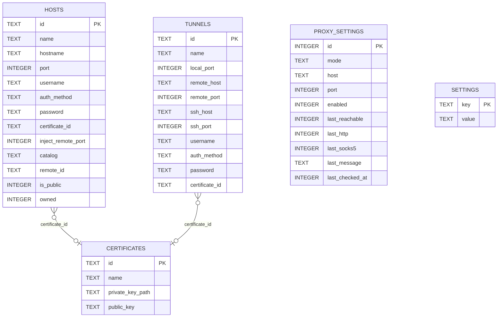
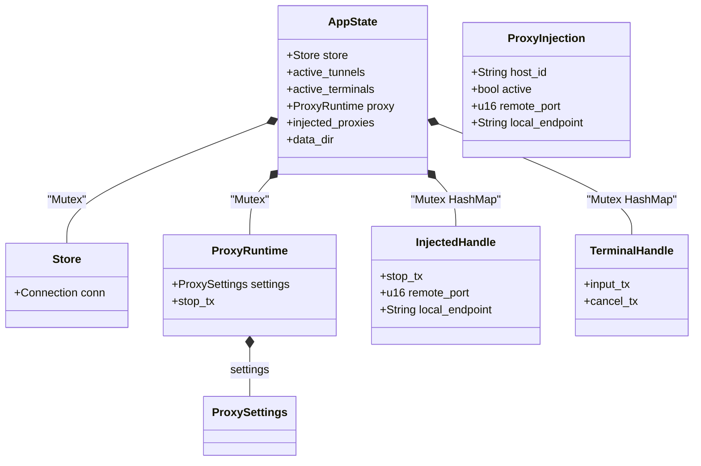

# Cangling Keeper

A browser-based local management service built with **Rust + Axum**, targeting
**Windows** and **Linux**. It manages remote hosts and exposes its interface on
the local loopback address.

## Features

- Define, edit, and delete SSH hosts (name, hostname/IP, port, username, password).
- Select a host and run a command over SSH, showing stdout/stderr/exit status.
- Define SSH local port-forward tunnels (`ssh -N -L ...`) — paste an SSH command
  to auto-fill the form, or fill the fields manually.
- Connect/disconnect tunnels; the list shows live connection state.
- Tunnel auth via password or an ed25519 key pair (generate one in-app).
- 软件仓库：缺省仅保留 Git 仓库 `cangling-repo`。克隆和更新均使用 `--depth 1` 浅拉取，只同步指定分支（未指定时使用远端默认分支），不拉取标签；初次克隆显式使用 `--single-branch`。升级时清理旧列表项，保留已下载文件和现有 `cangling-repo` 连接配置。同步大文件时显示下载/克隆进度，并可浏览目录与文本文件内容。
- 主机面板可将本地已拉取的软件同步到 Master 主机上 cangling-update 的 `repo/<软件集>/` 目录（按软件集名分目录，避免同名覆盖）。已存在且大小、SHA-256 都相同的文件会跳过，避免 `version.txt` 这类等长变更被漏传。
- 集群管理：SSH 探测该主机 cangling-update 的实际监听端口后，用主机地址 + 服务端口直接打开 `/console`（`install-service` 后端口变化也会跟上；探测不到时缺省 5400）。
- Hosts and tunnels persist to a SQLite database in the app data directory.

> **Security note (current state):** passwords are stored in plain text in the
> local SQLite database, and SSH host keys are not yet verified
> (trust-on-first-use is a planned improvement). Treat this as a local tool on a
> trusted machine for now.

## Data model

### SQLite schema

Stored in `<app_data_dir>/data.sql`. Authentication is denormalized per row
(`auth_method` + `password` + `certificate_id`); `certificate_id` is only set
when `auth_method = 'certificate'` and references `certificates.id` (a logical
foreign key, not enforced by SQLite). `hosts.remote_id` is the server-side host
id used for sync.



- `proxy_settings` is a singleton row (`id = 1`).
- `settings` is a generic key/value store (server URL, login token, username,
  nickname).

### Rust structs

Core domain and DTO structs (see `src/host.rs`, `src/auth.rs`,
`src/certificate.rs`, `src/tunnel.rs`, `src/proxy.rs`, `src/sync.rs`,
`src/host_actions.rs`, `src/ssh.rs`).


Enum variants carry data:

- `Auth::Password { password }`, `Auth::Certificate { certificate_id }`
- `ResolvedAuth::Password(String)`, `ResolvedAuth::Key(String)`

### Runtime state



- `AppState` is the shared server state; the maps and handles are guarded
  by `Mutex` and hold tokio `oneshot`/`mpsc` senders used to cancel active
  tunnels, terminals and proxy injections.

## Project structure

```
cangling-keeper/
├── Cargo.toml              # Rust crate and server dependencies
├── src/
│   ├── main.rs             # Entry point
│   ├── lib.rs              # Shared service state and business logic
│   ├── web.rs              # Axum HTTP/WebSocket server and API dispatcher
│   ├── host.rs             # Host model
│   ├── tunnel.rs           # Tunnel model + SSH command parsing
│   ├── store.rs            # SQLite persistence (hosts + tunnels)
│   ├── repo.rs             # 软件仓库：软件集 manifest 同步 + 目录/文件浏览
│   └── ssh.rs              # SSH exec, port forwarding, key generation (russh)
└── ui/                     # Frontend (plain HTML/CSS/JS, no bundler)
    ├── index.html
    ├── styles.css
    └── main.js
```

The frontend is dependency-free. It calls the Rust service through JSON APIs;
terminal output and long-task progress are delivered through WebSocket.

SSH is implemented with [`russh`](https://crates.io/crates/russh) (pure-Rust,
async) using its `ring` crypto backend, which avoids OpenSSL/libssh2 C
dependencies and needs no extra system libraries beyond a C compiler.

## Prerequisites

### Both platforms

- [Rust](https://rustup.rs) (stable toolchain)
### Linux (Debian/Ubuntu)

#### Build dependencies (compile-time only)

These are required only to *build* the app (headers + toolchain). End users do
not need them:

```sh
sudo apt update
sudo apt install build-essential pkg-config
```

### Windows

- Windows 7 SP1 or newer is supported by release binaries. The release workflow
  uses Rust's `x86_64-win7-windows-msvc` target so the executable does not
  import the Windows 10-only `ProcessPrng` entry point.
- Microsoft Visual Studio **C++ Build Tools** with the "Desktop development
  with C++" workload (MSVC).
- Rust **MSVC** toolchain (`rustup default stable-msvc`).
- WebView2 is not required.

## Run (development)

```sh
cargo run
```

This embeds the frontend, starts the local service and opens the system browser:

```sh
cargo run
```

On startup, Keeper creates a desktop shortcut if one does not already exist
(`cangling-keeper.lnk` on Windows or `cangling-keeper.desktop` on Linux). Opening
the shortcut starts the service and opens its home page. If Keeper is already
running, the second process exits after opening the existing home page instead
of starting another service instance.

The default URL is `http://127.0.0.1:4301`. Optional arguments:

```sh
cangling-keeper --listen 127.0.0.1:4301 --no-open
cangling-keeper --data-dir D:\cangling-keeper-data
```

Keep the listener on `127.0.0.1` unless authentication and HTTPS are provided
by a trusted reverse proxy. The Web service uses the same platform data
directory and SQLite database used by earlier releases. Browser-to-server calls
use JSON and live terminal/status events use WebSocket.

## Build a release binary

```sh
cargo build --release
```

The executable is written to `target/release/`.

## Adding commands

1. Add the operation to the dispatcher in `src/web.rs`.
2. Call it from `ui/main.js` with `window.__KEEPER__.core.invoke("name", { args })`
   (argument names use camelCase, e.g. Rust `host_id` → JS `hostId`).

### Data location

Hosts and tunnels are stored in a SQLite database at
`<app_data_dir>/data.sql`, where `<app_data_dir>` is the platform's per-user
application data directory:

- **Linux:** `~/.local/share/cn.cangling.keeper/`
- **Windows:** `%APPDATA%\cn.cangling.keeper\`
- **macOS:** `~/Library/Application Support/cn.cangling.keeper/`

Generated SSH keys are written to `<app_data_dir>/keys/`. The directory is
created automatically on first launch.

Older builds stored data in `./config/` relative to the working directory.
That directory is migrated into the data directory automatically on first
launch, if the data directory does not already contain a database.

## 隧道诊断与 Windows 日志

本地隧道详情显示最近连接的阶段、错误和时间。监听成功只代表转发端口已经建立；
WSS 会在有连接访问时握手，成功后继续等待目标 SSH 的响应。错误保留在详情和
隧道列表中，下一次连接活动会更新状态；刷新页面可重新读取当前进程的状态。
程序重启后的历史记录可通过“查看日志”查看（显示最近 64 KB）。

日志路径为 `<app_data_dir>/logs/cangling-keeper.log`。Windows 默认是
`%LOCALAPPDATA%\cn.cangling.keeper\logs\cangling-keeper.log`，使用 `--data-dir`
时位于指定目录下。日志使用本地时间 `yyyy-MM-dd HH:mm:ss`，达到 5 MB 时轮转，
另保留 `.log.1` 至 `.log.3`。记录服务启动、监听状态、WSS 握手与传输错误，
不记录私钥、签名头、TCP 数据内容或认证口令。


### Named certificate synchronization

In **本地证书**, use **修改名称** to rename an existing key without regenerating it.
**同步到账号服务器** synchronizes certificate names and both key files under the
current login account. Login synchronization and the main sync button also include
certificates. New/imported certificates and names saved while logged in are synced
automatically. Offline name edits remain local until the next successful sync.
Keys are matched by their Ed25519 public-key fingerprint, independent of comments.

This requires the matching `gwt-template` server update providing
`GET /api/v1/certificate/list` and `POST /api/v1/certificate/save`.
The server initializes `cangling_certificate` on startup and isolates records by
login user. This account synchronization does not authorize WSS access on a host;
that still requires its `tunnel_authorized_keys` configuration.

## Keeper 更新

“检查更新”仅使用 `https://soft.cangling.cn:22002/software/operator/latest/version.txt`。
发现新版本时，“更新至版本号”会在 Keeper 服务所在电脑下载、验证、替换程序并重启（浏览器所在平台不影响选择）：

- Linux AMD64：`https://soft.cangling.cn:22002/software/operator/latest/cangling-keeper-linux-amd64`
- Linux ARM64：`https://soft.cangling.cn:22002/software/operator/latest/cangling-keeper-linux-arm64`
- Windows x86_64：`https://soft.cangling.cn:22002/software/operator/latest/cangling-keeper-windows-x86_64.exe`

更新保留原启动参数、工作目录和数据目录。下载完成后先验证程序架构、可运行性及版本，再由独立辅助进程等待旧进程退出、备份并替换程序；新程序健康检查失败会恢复旧程序并重启。页面等待服务恢复后自动刷新。程序目录必须可写，且更新操作仅允许本机同源页面执行。旧版只有浏览器下载功能的 Keeper 需先手动替换一次，才能获得此自动更新能力。
GitHub Actions 使用原生 Linux AMD64、ARM64 和 Windows runner 构建；所有软件包上传成功后才发布版本标记。

软件中心上传使用 `CANGLING_TOKEN`（API 凭证）和 `KEEPER_SOFTWARE_TOKEN`（soft 软件中心 operator 软件的上传 Token）。下载地址中的软件 ID 不作为上传 Token。

发布上传入口：`https://soft.cangling.cn:22002/api/v1/software/upload`；客户端版本检查和下载也使用上面的 soft 地址。

Windows 发布现已接入现有苍灵根 CA 签发的独立代码签名证书；上传前自动签名、添加时间戳并验证。部署到受管理的 Windows 电脑时仍需信任苍灵根 CA。证书、Secrets 配置和测试方式见 [Windows 签名说明](docs/windows-signing.md)。

顶部“安装根证书”支持 Windows（UAC 授权）、Ubuntu 和麒麟（系统授权框）；检查安装状态、展示指纹并在确认后写入系统信任库，详见上面的 Windows 签名说明。安装目标是运行 Keeper 的本机。
软件仓库在首次访问时即创建本地目录；目录为空时仍显示“未同步”，点击“同步”才拉取仓库内容。
