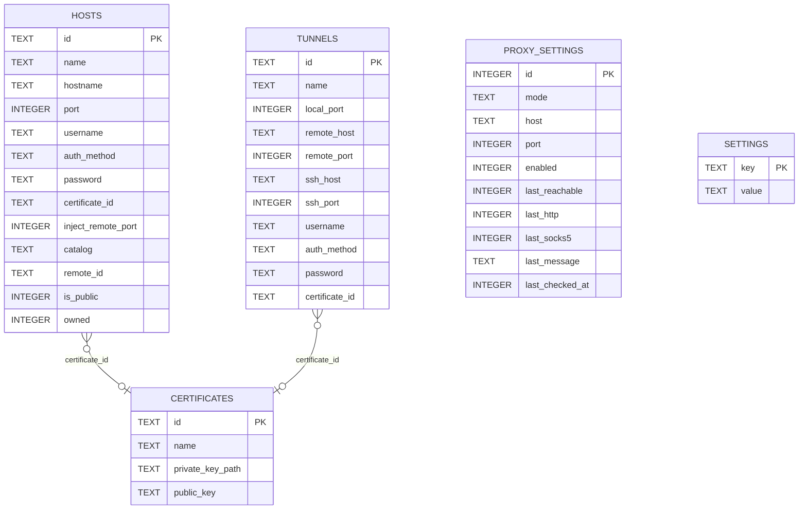
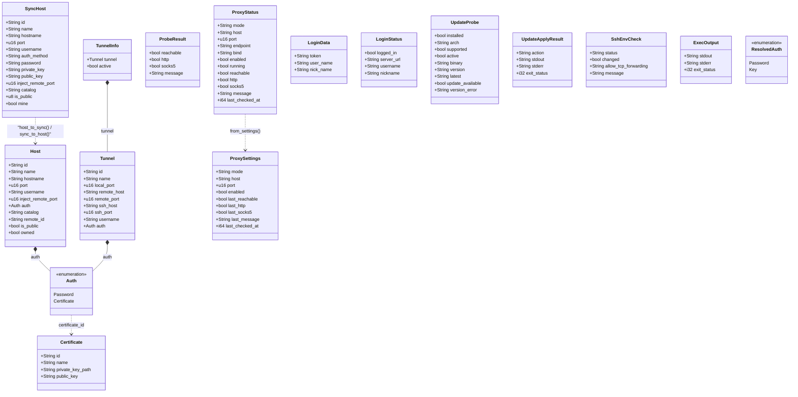
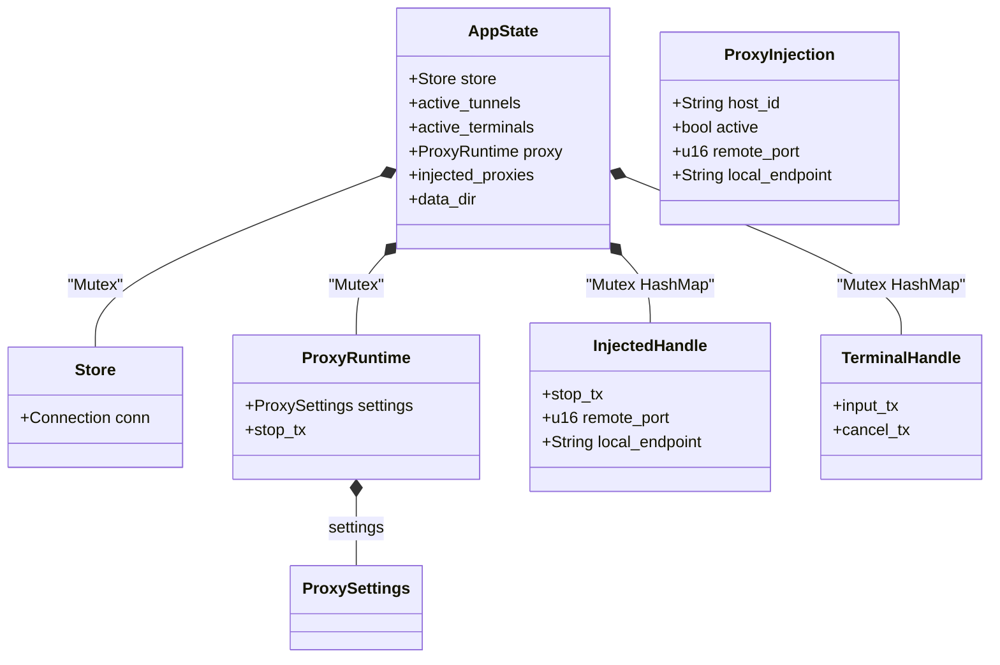

# Cangling Keeper

A browser-based local management service built with **Rust + Axum**, targeting
**Windows** and **Linux**. It manages remote hosts and exposes its interface on
the local loopback address.

## Features

- Define, edit, and delete SSH hosts (name, hostname/IP, port, username, password).
- Select a host and run a command over SSH, showing stdout/stderr/exit status.
- Define SSH local port-forward tunnels (`ssh -N -L ...`) — paste an SSH command
  to auto-fill the form, or fill the fields manually.
- Connect/disconnect tunnels; the list shows live connection state.
- Tunnel auth via password or an ed25519 key pair (generate one in-app).
- 软件仓库：缺省使用 HTTP 网盘目录 `cangling-repo`，内置只读连接配置，不需要 Git/LFS 或维护中心登录。递归同步支持 Range 断点续传、SHA-256 校验和已有内容复用，完整验证后切换资源快照；失败保留旧资源。升级时迁移原 cangling-repo Git 连接，保留本地文件直到新快照同步成功。手动配置的其他 Git/Manifest 同步能力保持兼容。
- 主机面板可将本地已拉取的软件同步到 Master 主机上 cangling-update 的 `repo/<软件集>/` 目录（按软件集名分目录，避免同名覆盖）。已存在且大小、SHA-256 都相同的文件会跳过，避免 `version.txt` 这类等长变更被漏传。
- 集群管理：SSH 探测该主机 cangling-update 的实际监听端口后，用主机地址 + 服务端口直接打开 `/console`（`install-service` 后端口变化也会跟上；探测不到时缺省 5400）。
- Hosts and tunnels persist to a SQLite database in the app data directory.

> **Security note (current state):** passwords are stored in plain text in the
> local SQLite database, and SSH host keys are not yet verified
> (trust-on-first-use is a planned improvement). Treat this as a local tool on a
> trusted machine for now.

## Data model

### SQLite schema

Stored in `<app_data_dir>/data.sql`. Authentication is denormalized per row
(`auth_method` + `password` + `certificate_id`); `certificate_id` is only set
when `auth_method = 'certificate'` and references `certificates.id` (a logical
foreign key, not enforced by SQLite). `hosts.remote_id` is the server-side host
id used for sync.



- `proxy_settings` is a singleton row (`id = 1`).
- `settings` is a generic key/value store (server URL, login token, username,
  nickname).

### Rust structs

Core domain and DTO structs (see `src/host.rs`, `src/auth.rs`,
`src/certificate.rs`, `src/tunnel.rs`, `src/proxy.rs`, `src/sync.rs`,
`src/host_actions.rs`, `src/ssh.rs`).



Enum variants carry data:

- `Auth::Password { password }`, `Auth::Certificate { certificate_id }`
- `ResolvedAuth::Password(String)`, `ResolvedAuth::Key(String)`

### Runtime state



- `AppState` is the shared server state; the maps and handles are guarded
  by `Mutex` and hold tokio `oneshot`/`mpsc` senders used to cancel active
  tunnels, terminals and proxy injections.

## Project structure

```
cangling-keeper/
├── Cargo.toml              # Rust crate and server dependencies
├── src/
│   ├── main.rs             # Entry point
│   ├── lib.rs              # Shared service state and business logic
│   ├── web.rs              # Axum HTTP/WebSocket server and API dispatcher
│   ├── host.rs             # Host model
│   ├── tunnel.rs           # Tunnel model + SSH command parsing
│   ├── store.rs            # SQLite persistence (hosts + tunnels)
│   ├── repo.rs             # 软件仓库：软件集 manifest 同步 + 目录/文件浏览
│   └── ssh.rs              # SSH exec, port forwarding, key generation (russh)
└── ui/                     # Frontend (plain HTML/CSS/JS, no bundler)
    ├── index.html
    ├── styles.css
    └── main.js
```

The frontend is dependency-free. It calls the Rust service through JSON APIs;
terminal output and long-task progress are delivered through WebSocket.

SSH is implemented with [`russh`](https://crates.io/crates/russh) (pure-Rust,
async) using its `ring` crypto backend, which avoids OpenSSL/libssh2 C
dependencies and needs no extra system libraries beyond a C compiler.

## Prerequisites

### Both platforms

- [Rust](https://rustup.rs) (stable toolchain)
### Linux (Debian/Ubuntu)

#### Build dependencies (compile-time only)

These are required only to *build* the app (headers + toolchain). End users do
not need them:

```sh
sudo apt update
sudo apt install build-essential pkg-config
```

### Windows

- Windows 7 SP1 or newer is supported by release binaries. The release workflow
  uses Rust's `x86_64-win7-windows-msvc` target so the executable does not
  import the Windows 10-only `ProcessPrng` entry point.
- Microsoft Visual Studio **C++ Build Tools** with the "Desktop development
  with C++" workload (MSVC).
- Rust **MSVC** toolchain (`rustup default stable-msvc`).
- WebView2 is not required.

## Run (development)

```sh
cargo run
```

This embeds the frontend, starts the local service and opens the system browser:

```sh
cargo run
```

On startup, Keeper creates a desktop shortcut if one does not already exist
(`cangling-keeper.lnk` on Windows or `cangling-keeper.desktop` on Linux). Opening
the shortcut starts the service and opens its home page. If Keeper is already
running, the second process exits after opening the existing home page instead
of starting another service instance.

The default URL is `http://127.0.0.1:4301`. Optional arguments:

```sh
cangling-keeper --listen 127.0.0.1:4301 --no-open
cangling-keeper --data-dir D:\cangling-keeper-data
```

Keep the listener on `127.0.0.1` unless authentication and HTTPS are provided
by a trusted reverse proxy. The Web service uses the same platform data
directory and SQLite database used by earlier releases. Browser-to-server calls
use JSON and live terminal/status events use WebSocket.

## Build a release binary

```sh
cargo build --release
```

The executable is written to `target/release/`.

## Adding commands

1. Add the operation to the dispatcher in `src/web.rs`.
2. Call it from `ui/main.js` with `window.__KEEPER__.core.invoke("name", { args })`
   (argument names use camelCase, e.g. Rust `host_id` → JS `hostId`).

### Data location

Hosts and tunnels are stored in a SQLite database at
`<app_data_dir>/data.sql`, where `<app_data_dir>` is the platform's per-user
application data directory:

- **Linux:** `~/.local/share/cn.cangling.keeper/`
- **Windows:** `%APPDATA%\cn.cangling.keeper\`
- **macOS:** `~/Library/Application Support/cn.cangling.keeper/`

Generated SSH keys are written to `<app_data_dir>/keys/`. The directory is
created automatically on first launch.

Older builds stored data in `./config/` relative to the working directory.
That directory is migrated into the data directory automatically on first
launch, if the data directory does not already contain a database.

## 隧道诊断与 Windows 日志

本地隧道详情显示最近连接的阶段、错误和时间。监听成功只代表转发端口已经建立；
WSS 会在有连接访问时握手，成功后继续等待目标 SSH 的响应。错误保留在详情和
隧道列表中，下一次连接活动会更新状态；刷新页面可重新读取当前进程的状态。
程序重启后的历史记录可通过“查看日志”查看（显示最近 64 KB）。

日志路径为 `<app_data_dir>/logs/cangling-keeper.log`。Windows 默认是
`%LOCALAPPDATA%\cn.cangling.keeper\logs\cangling-keeper.log`，使用 `--data-dir`
时位于指定目录下。日志使用本地时间 `yyyy-MM-dd HH:mm:ss`，达到 5 MB 时轮转，
另保留 `.log.1` 至 `.log.3`。记录服务启动、监听状态、WSS 握手与传输错误，
不记录私钥、签名头、TCP 数据内容或认证口令。


### Named certificate synchronization

In **本地证书**, use **修改名称** to rename an existing key without regenerating it.
**同步到账号服务器** synchronizes certificate names and both key files under the
current login account. Login synchronization and the main sync button also include
certificates. New/imported certificates and names saved while logged in are synced
automatically. Offline name edits remain local until the next successful sync.
Keys are matched by their Ed25519 public-key fingerprint, independent of comments.

This requires the matching `gwt-template` server update providing
`GET /api/v1/certificate/list` and `POST /api/v1/certificate/save`.
The server initializes `cangling_certificate` on startup and isolates records by
login user. This account synchronization does not authorize WSS access on a host;
that still requires its `tunnel_authorized_keys` configuration.

## Keeper 更新

“检查更新”仅使用 `https://soft.cangling.cn:22002/software/operator/latest/version.txt`。
发现新版本时，“更新至版本号”会在 Keeper 服务所在电脑下载、验证、替换程序并重启（浏览器所在平台不影响选择）：

- Linux AMD64：`https://soft.cangling.cn:22002/software/operator/latest/cangling-keeper-linux-amd64`
- Linux ARM64：`https://soft.cangling.cn:22002/software/operator/latest/cangling-keeper-linux-arm64`
- Windows x86_64：`https://soft.cangling.cn:22002/software/operator/latest/cangling-keeper-windows-x86_64.exe`

更新保留原启动参数、工作目录和数据目录。下载完成后先验证程序架构、可运行性及版本，再由独立辅助进程等待旧进程退出、备份并替换程序；新程序健康检查失败会恢复旧程序并重启。页面等待服务恢复后自动刷新。程序目录必须可写，且更新操作仅允许本机同源页面执行。旧版只有浏览器下载功能的 Keeper 需先手动替换一次，才能获得此自动更新能力。
GitHub Actions 使用原生 Linux AMD64、ARM64 和 Windows runner 构建；所有软件包上传成功后才发布版本标记。

软件中心上传使用 `CANGLING_TOKEN`（API 凭证）和 `KEEPER_SOFTWARE_TOKEN`（soft 软件中心 operator 软件的上传 Token）。下载地址中的软件 ID 不作为上传 Token。

发布上传入口：`https://soft.cangling.cn:22002/api/v1/software/upload`；客户端版本检查和下载也使用上面的 soft 地址。

Windows 发布现已接入现有苍灵根 CA 签发的独立代码签名证书；上传前自动签名、添加时间戳并验证。部署到受管理的 Windows 电脑时仍需信任苍灵根 CA。证书、Secrets 配置和测试方式见 [Windows 签名说明](docs/windows-signing.md)。

顶部“安装根证书”支持 Windows（UAC 授权）、Ubuntu 和麒麟（系统授权框）；安装与 cangling-update 一致的新 `Cangling Root CA`（SHA-256：`0285F51BB6BEA21C74AD8C13320FFFB3C940438C54A4D8384A3FF2E78E6EBCD1`），检查安装状态、展示指纹并在确认后写入系统信任库。原 Windows EXE 代码签名根证书单独保留，详见上面的 Windows 签名说明。安装目标是运行 Keeper 的本机。
软件仓库在首次访问时即创建本地目录；目录为空时仍显示“未同步”，点击“同步”才拉取仓库内容。

软件仓库同步将 Git 索引检出和 Git LFS 大文件下载分开显示；大文件下载、检出和 SHA-256 校验全部通过后才标记同步完成。下载失败会保留缓存，重新同步可补下载；完成或失败后收起进度条。首次使用此验证逻辑时，旧克隆需再同步一次。

本地隧道的更多菜单提供“上传同步”：明确确认后使用本地配置覆盖服务器并读回核对。编辑后未上传的配置不会被普通同步覆盖；旧维护中心不支持 WSS 字段时会报告错误。WSS 同步需要维护中心更新相应字段。

软件仓库同步期间会阻止在线升级和退出，避免旧 Keeper 退出后遗留 Git/LFS 子进程。Windows 上仓库 Git 命令在恢复执行前加入带 `KILL_ON_JOB_CLOSE` 的 Job Object，管理 Git、LFS 及其后代；正常服务关闭会主动结束这些任务，进程被强制终止时也由系统清理。同一仓库的重复同步会被拒绝。遇到 `index.lock` 时，仅在两次检查均无 Git/LFS 进程、锁超过 30 秒且未变化的情况下清理；活动锁或无法确认归属的锁保持不动，不会批量终止其他 Git 进程。

仓库可直连但 LFS 下载反复出现 `EOF` 时，检查 `HTTP_PROXY` / `HTTPS_PROXY` 和 `NO_PROXY`。LFS 文件下载域名可能与克隆域名不同；需要直连的两个域名都应加入 `NO_PROXY`，修改后重启 Keeper 使其继承新环境。不要通过关闭 TLS 校验排障。

### 网盘目录来源

`cangling-repo` 缺省来源为 `https://soft.cangling.cn:22002` 的既有网盘目录。程序内置目录 ID 和读取 key，也可在软件集设置中编辑网盘地址、目录 ID、读取 key，或使用 `CANGLING_DRIVE_URL` / `CANGLING_DRIVE_DIRECTORY` / `CANGLING_DRIVE_TOKEN` 覆盖。SQLite 软件集配置沿用兼容字段（gitUrl=网盘地址、gitBranch=目录 ID、gitToken=读取 key），类型为 `drive`；首次升级会迁移旧的同名 Git 配置，不删除现有文件。

只有完整校验且发布成功才显示为已同步。临时文件、断点和发布日志保存在软件集旁的隐藏 `.cangling-repo.drive-sync` 中，跨进程锁防止并行发布；下载中断后重新同步自动续传。成功发布后本地目录与网盘快照一致，旧 Git 元数据、远端已删除及本地额外文件会随旧快照清理。读取 key 不出现在 URL 或同步日志中，不跟随重定向。

### 发布到网盘

标签 release 继续上传 GitHub Release 和软件仓库，同时将程序写入
`cangling-repo/binaries/linux/{amd64,arm64}`；Keeper Windows 程序写入
`binaries/windows/amd64/cangling-keeper.exe`。Linux 程序分别保留
`cangling-update`、`cangling-keeper` 文件名。两个 GitHub 仓库均需配置
Actions Secret `WRITE_TOKEN`（该目录的读、写、删除权限），凭证不写入工作流源码。

所有平台程序校验成功后，update 才更新 `binaries/VERSION`；Keeper 更新
`binaries/KEEPER_SHA256SUMS` 和 `binaries/KEEPER_VERSION`。重复运行会跳过相同
SHA-256 的文件。现有网盘 API 无同名覆盖接口，更新单个文件需先删除旧条目再上传，
会存在短暂不可用窗口；上传失败时不更新版本标记，可重跑发布任务。

Linux 根证书采用带 SHA-256 指纹的独立文件名安装，新旧 CA 可并存；升级不会覆盖已有的 `cangling-root-ca.crt` 或移除旧信任。系统信任库更新失败时，仅回滚本次新建的证书文件。


## 智能体工作台（第一阶段）

主界面采用会话侧边栏、消息时间线和底部输入框。现有主机、隧道、代理、证书、软件仓库、根证书安装及应用更新入口统一收进“账号 → 安全”；账号登录和同步位于“账号”页。

启用模型后，会话后台使用原生 tool_calls 执行只读 Agent 循环。未启用模型时，消息保存为本地会话并返回本地回执；原有手动运维工具继续通过“工具”菜单使用。

- `src/agent.rs`：会话服务、工具注册表、工具调用和审批状态。模型层通过独立的项目只读工具注册表执行文件查询；运维工具保留原有审批入口。
- `agent_sessions`、`agent_messages`、`agent_runs`：保存在既有 `data.sql` SQLite 数据库。刷新保留消息、结果和待确认请求。
- 只读工具包括主机列表、隧道列表、代理、软件仓库及根证书状态。列表输出过滤密码和私钥信息。
- 远程 SSH 命令先持久化为待确认请求，展示具体主机及完整命令；只有显式确认后才执行。服务端保存原始参数，不接受确认请求替换命令。确认不可重放，目标地址或账号变化会拒绝执行。
- 程序重启将执行中的工具标记为中断，不自动重试远程操作；用户应先核对远端实际状态。等待超时也不代表远端进程已经停止。
- 智能体接口只允许本机同源调用；文件工具事件同样只向本机同源 WebSocket 连接发送。启用模型后，会发送当前会话及本次工具结果到选定的模型服务。

新增界面资源为 `ui/agent.js` 和 `ui/agent.css`，原有运维组件保留在账号安全页。数据库中的会话可能包含手动输入的命令和输出，请按本机维护数据保管。

会话按项目管理，首次启动自动创建“通用项目”，旧会话自动归入此项目。每个项目在 Keeper 服务运行用户的 `~/cangling/projects/<项目ID>` 下拥有独立目录（通用项目为 `general`）；名称和目录映射保存在 SQLite 中。侧栏可新建和切换项目，显示当前项目的会话与目录。项目目录是模型只读文件工具的访问边界；远程 SSH 工具仍在所选远程主机执行。

账户与同步现在对接现场 CIS Server，未设置地址时默认使用 `https://train.cangling.cn/ib/`，已有自定义地址保留：账户页只读显示 Server URL，在登录框中修改地址并使用现场 CIS 用户登录。地址可包含反向代理前缀，保存在本机 SQLite；更换服务器会清除旧登录状态。需要 CIS 安装 `/api/v1/keeper` API；打开登录框自动获取验证码，图片位于输入框右侧，点击图片和登录失败后都会刷新；验证码由用户填写。同步表及部署说明位于 CIS 仓库 `doc/keeper/README.md`。软件仓库资源和应用自更新地址独立于该账号服务器。

DeepSeek：账户页的“模型服务”可配置 API 地址（默认 `https://api.deepseek.com`）、模型（默认 `deepseek-flash`）、API Key 和启用状态。支持模型列表连接测试、后台多轮文字回复以及刷新后的等待状态恢复。配置与密钥仅存本机 SQLite，不回显 Key，不同步到 CIS；Unix 下数据库权限设为 0600。密钥为本机数据库内存储，并非独立加密保险库。更换 API 地址须重新输入密钥。停用后恢复手动工具模式。模型仅接收当前会话最近最多24条文字消息，正文合计最多64KB；模型可在当前项目内自主调用目录列表、文本读取和字面搜索工具，查询结果回传模型供下一轮生成；主机凭证不加入请求，远程命令仍需显式确认。连接测试仅请求 `/models`，对话请求 `/chat/completions`。没有配置真实 Key 时，可运行 `python3 scripts/test-deepseek-http.py` 使用本机模拟接口验证，无外部费用。

DeepSeek 回复使用 SSE 流，生成中的同一条助手消息会持续写入 SQLite，并通过 WebSocket 向页面推送；断线使用会话快照轮询补齐。刷新后恢复部分正文及生成状态，不会再次调用模型。浏览器关闭不终止后台生成；Keeper 服务本身重启时保留部分正文并标记请求中断，不会自动重复付费请求。

模型服务已支持多 LLM Server 列表：添加及编辑对话框中配置名称、API 类型、地址、模型和独立密钥；支持 DeepSeek 及 OpenAI 兼容 Chat Completions。每项可独立测试连接，并用“用于对话”切换当前服务。新增服务不会替换已有服务或其密钥。现有 DeepSeek 单服务配置自动迁移至 SQLite 的 `agent_llm_servers` 表，当前选择与密钥保持不变，旧设置中的密钥副本迁移后移除。编辑密钥留空仅保留该服务的密钥，更换地址必须重新输入；所有接口只返回 hasApiKey 标志。OpenAI 兼容请求不附加 DeepSeek 专用 thinking 字段。

对话输入框工具栏提供模型选择器，只列出已启用且已配置密钥的 LLM Server，使用“服务名称 · 模型”区分同名模型。切换使用现有当前服务设置，保留输入草稿；生成中暂时禁用选择器，完成后恢复。

会话模型选择单独存于 `agent_sessions.server_id`：输入框模型菜单仅修改当前会话，不修改默认服务或其他会话。创建会话时固定当时的新会话默认服务；旧会话迁移时保留迁移前选择。刷新、切换会话及重启后恢复各自的模型。账户页的“设为新会话默认”只影响之后创建的会话；已选服务停用或密钥不可用时提示重新选择，不自动改用其他服务。生成中的会话禁止更换模型，其他会话仍可独立选择和生成。

每条模型回复独立持久化 `model_metadata`：记录服务 ID、当时服务名称、请求模型及服务端返回的模型标识。回复头部显示该条回复的模型；切换会话模型、编辑服务名称或模型配置不会重写历史标识。API 返回具体版本时优先显示返回值，悬停可查看请求模型。旧回复不推测补填模型，显示“模型未记录”；新的本地工具说明显示“本地工具”。模型元数据不包含密钥，也不发送回模型 API。

回复支持本机 Markdown 渲染（Marked + DOMPurify），代码块使用 Highlight.js 高亮并提供“复制代码”。所有库固定版本内置，许可证和来源摘要记录在 `ui/vendor/markdown-dependencies.json`，无需访问 CDN。流式回复与刷新恢复使用同一渲染器；原始 Markdown 仍存 SQLite，代码复制使用原始代码文本。模型提供的原始 HTML 按文字展示，输出经标签白名单清理，禁止脚本和危险链接；Markdown 图片不自动发起外部请求。测试：`NODE_PATH=<jsdom 安装目录>/node_modules node scripts/test-markdown.cjs`。

数学公式使用本机 KaTeX 渲染，支持 `$...$`、`$$...$$`、`\(...\)`、`\[...\]`，代码块与行内代码内不解析公式。KaTeX 设置 `trust:false`，禁止不可信外链及 HTML 命令。折叠区域支持 `details/summary`，包括示例中反斜杠转义的标签，折叠内容可含 Markdown 与公式；其他 HTML 仍按文本展示。流式增量渲染保留已展开折叠区的状态。

流式生成期间，发送按钮替换为“停止生成”。停止以会话 ID 和本次回复 ID 精确定位，取消等待响应头或正在读取的 HTTP 流，保存已接收内容并将该回复标记为 `stopped`；刷新及重启后显示“已停止生成”。后台其他会话不受影响。过期的停止请求不会取消新的回复，不会自动重试或重新请求模型。

用户消息下方提供“编辑”，在原位置修改并保存后，使用该轮原回复的模型和上下文生成新回复；原消息与原回复均不覆盖。消息版本箭头同步切换其对应的回复集合，刷新及重启后保留所选版本。编辑历史问题不会将之后的消息加入该次重新生成请求。生成期间禁用编辑和版本切换。

每条模型回复下方提供“重新生成”，保留原回复，在原位置生成新版本，停止或中断的回复也支持。回复下方通过左右箭头及版本计数切换；选择保存到本机 SQLite `agent_reply_versions`，刷新、切换会话及重启后恢复。后续请求只使用各条回复当前选中的版本作为上下文，其他版本不重复发送。新请求使用原回复的服务 ID、请求模型及原始上下文，不改变会话选择；新生成请求同样可停止。原始请求上下文快照保存在本机 `agent_model_contexts`，旧回复无快照时只重建到原回复之前的消息，不包含后续消息。原服务停用、密钥不可用或已记录的 API 地址/类型变更时拒绝请求，不自动切换其他服务。缺少原模型记录的历史回复和本地工具说明不支持重新生成。


## 项目 Agent 循环

`src/model.rs` 聚合 SSE 分片中的原生工具调用，完整收到 `finish_reason=tool_calls` 和流结束后才执行；执行结果以 `role=tool` 和原始 `tool_call_id` 回传模型，直到文字回复完成。只读工具为 `list_directory`、`read_file`、`search_files`。新增 `write_file`、`apply_patch`、`run_command` 需逐项展示并确认；不向模型开放原有 SSH 工具。所选模型须支持 OpenAI 兼容原生工具调用；不支持时明确报错，不自动切换模型。

`src/agent_files.rs` 使用 `cap-std` 的目录能力句柄固定当前项目边界；拒绝绝对路径、`..`、符号链接和特殊文件，跳过常见密钥文件、`.env`、`.git` 及构建缓存。文本读取限 UTF-8、1 MiB 文件、每次 200 行；搜索为字面字符串，最多 50 个匹配、3000 个条目、16 MiB 扫描数据。工具每次检查取消及 8 秒时限，单个结果最多约 24 KB。循环最多 8 轮、32 次工具调用和累计 180 秒执行时间（等待人工确认不计入）；达到限制保留记录并结束。

`src/agent_runtime.rs` 复用 `agent_runs` 存工具参数、状态及输出，用 `response_id` 关联回复版本；新增 `agent_tasks` 保存轮数、项目目录快照和任务状态，`agent_events` 保存任务/工具事件。页面通过 WebSocket 显示执行过程，快照轮询补齐断线期间状态。工具卡片可展开参数和结果，切换历史回复只显示该版本的工具记录。

“停止生成”取消整个模型/工具循环，保留已有文字和工具结果；浏览器刷新、关闭不重复启动任务。Keeper 重启后，将未完成任务及运行中工具标记中断，保留历史，不自动重放请求。只读工具不会修改项目内容。确认后的写入和命令可能产生实际效果，停止生成不会回滚已经完成的操作。

验证命令：`cargo test --locked --lib -- --test-threads=1`、`python3 scripts/test-react-http.py`、`python3 scripts/test-deepseek-http.py`。前端工具卡片测试：`NODE_PATH=<jsdom 安装目录>/node_modules node scripts/test-react-ui.cjs`。ReAct HTTP 测试使用本机模拟模型，覆盖多轮工具调用、实时事件、刷新恢复、停止、版本隔离、路径限制和重启不重放，不调用付费模型；测试需要 Python `websockets`。`--preview` 提供独立浏览器验证站点。


## 写入、补丁与本机命令的确认

`src/agent_actions.rs` 在执行前准备不可变的操作预览。`write_file(path, content)` 创建或覆盖 UTF-8 文件；`apply_patch(path, oldText, newText)` 要求 oldText 非空且唯一匹配，并生成统一格式差异供审阅。文件工具仅接受项目相对路径，父目录必须已存在；拒绝符号链接、特殊文件、常见私密文件和缓存路径。写入内容最多 32 KiB，补丁目标/结果最多 128 KiB。用户确认后再次检查父目录标识及原内容 SHA-256，冲突时拒绝覆盖。写入采用同目录临时文件和原子替换，新文件采用不覆盖已有目标的创建；Keeper 内并发文件写入串行校验。

`run_command(command, cwd?, timeoutSeconds?)` 显示完整命令、shell、实际执行目录及超时后才执行。cwd 为项目内相对目录，超时默认 60 秒、最多 120 秒；stdin 关闭，stdout/stderr 分别实时保留开头和结尾各 4 KiB（两路合计最多 16 KiB），防止大量标准输出挤掉末尾错误；JSON 转义超限时进一步缩短片段。省略区域显示字节数，并通过 stdoutOmittedBytes/stderrOmittedBytes 与 outputTruncated 标记不完整结果。上下文预算进一步缩短结果时仍保留两路首尾、退出码和失败状态，并单独标记上下文省略。命令以 Keeper 用户权限运行，执行目录不是文件沙箱；使用最小环境变量集，不自动继承模型 Token 等环境变量。Unix 使用进程组，Windows 使用 Job Object 管理子进程。停止、超时及正常服务关闭会清理所属进程，并保留已捕获输出。

`agent_reviews` 将完整差异/命令及其摘要关联到唯一的 run_id。`agent_review_tool` 确认请求仅提交会话、run_id、预览摘要和同意/拒绝决定；不接受替换已审阅的操作内容。会话不匹配、摘要不符、停止后的请求、重复确认及旧手动工具接口均不能启动原生操作。确认状态使用数据库条件更新，只执行一次。拒绝结果回传模型；等待确认和执行中的状态均可在浏览器刷新后恢复。

服务重启保留审阅内容和输出，将未完成/待确认操作置为中断，不自动重放，也不沿用旧确认。结果不明的操作需要用户先核实。写入或命令已经完成时，即使随后停止生成，也保留真实执行结果。

额外验证：`python3 scripts/test-agent-actions-http.py` 使用独立临时项目和本机模拟模型，检查执行前无副作用、审批绑定/防重放、差异写入、补丁、文件及父目录冲突、拒绝、停止、输出捕获、超时和重启；`--preview` 提供浏览器审批测试站点。`NODE_PATH=<jsdom 安装目录>/node_modules node scripts/test-react-ui.cjs` 验证差异和命令的安全文本展示及确认按钮。

### 对话图片与文本附件

输入框支持选择或粘贴 PNG、JPEG、WebP 图片，以及 UTF-8 文本文件。每条消息最多4个附件；每张图片最多4 MiB、单边最多8192像素、总计最多2400万像素，每个文本文件最多64 KiB。附件原件以不可修改的 BLOB 存入本机 SQLite，并按账户和会话隔离；会话快照只返回附件名称、类型、大小、校验值及图片尺寸，预览时才读取内容。未发送的附件作为当前会话草稿保留，刷新后可恢复或移除。已绑定到消息的附件不能单独删除；编辑消息保留原版本，并让新版本引用原附件；永久删除会话时一并清理附件和关联。

图片不会自动发给所有模型。仅显式启用“支持图片”的本地模型可接收图片；未声明支持的模型会阻止发送当前图片，不会假装已经看过图片。文本附件作为不可信资料加入模型上下文。持久化的模型请求快照只保存文字和会话内附件引用；图片 base64 仅在真正请求模型时临时构造，不写入上下文快照。模型切换、重新生成及备份恢复都会重新校验引用，不能借附件ID访问其他账户或会话的文件。

验证：`python3 scripts/test-agent-attachments-http.py` 使用临时数据库和本机模拟模型，覆盖上传限制、账户与会话隔离、草稿删除、消息绑定、编辑版本、附件备份恢复和永久删除，不请求真实模型服务。

### 当前账户的对话备份与恢复

在“账户 → 备份与恢复”点击“下载对话备份”，下载带 SHA-256 完整性校验的 JSON 文件（最多 24 MiB）。备份来自 SQLite 一致性快照，包含当前账户的全部会话、原始消息及其版本关系、未发送文字草稿、选中版本、模型标识、历史请求上下文、工具执行记录与审批预览、图片与文本附件原件（含未发送草稿）及关联，以及这些会话关联的项目名称与 ID；未被会话引用的空项目不在此备份范围。备份不读取模型密钥、登录凭证、SSH 私钥、主机配置或项目目录文件。消息和工具输出本身可能包含敏感内容；JSON 备份没有加密，应妥善保管。

“从备份恢复”先校验文件并显示记录数量，用户确认后才导入当前账户。恢复采用数据库事务，新增会话和记录，不覆盖已有数据；允许导入其他账户的备份，界面会提示。相同 ID 与名称的已有项目会被复用，其他项目创建到本机 `~/cangling/projects/<新ID>`，不会使用文件内传入的任意路径，也不会恢复项目文件。消息、版本关系、工具记录和附件 ID 会统一映射，历史上下文中的附件引用也随之更新；若本机仍有相同模型服务则保留会话选择，否则使用当前新会话默认服务。历史模型名称不被改写。会话安全模式重置为“请求批准”，未完成工具和流式消息标记为中断，审批不可重放，不会发起模型或工具请求。重复导入会再次新增会话。

有文字草稿时使用第4版格式，含 MCP 图片时至少为第3版，普通附件至少为第2版，其他备份为第1版；继续兼容第1–3版旧备份。恢复文字草稿时为新会话建立独立修订号。导入会检查附件的实际类型、大小、图片尺寸、SHA-256及同会话引用，拒绝外部图片结构或伪造的上下文引用。24 MiB限制包含附件的base64编码；归档不会减少备份体积，超过上限时应先清理不需要的历史及回收站。

当前账户正在生成回复时不能恢复；恢复预览后如果切换账户，必须重新预览。历史摘要缓存可按需重建；备份不包含细粒度事件日志或运行中的任务。验证：`python3 scripts/test-history-backup-http.py`；界面测试：`NODE_PATH=<jsdom 路径>/node_modules node scripts/test-history-backup-ui.cjs`。

### MCP Server

在“账户 → MCP 服务”添加服务，选择本机 stdio、Streamable HTTP 或旧版 HTTP + SSE。stdio 填写可执行文件及逐行启动参数；远程服务填写 URL 和逐行请求头（例如 `IJ_MCP_SERVER_PROJECT_PATH: /path/to/project`）。远程地址要求 HTTPS，本机回环地址允许 HTTP；不跟随重定向，旧版 SSE 返回的 endpoint 必须与配置地址同源。保存后点击“连接并发现”；发现的服务能力会显示在服务列表；普通工具首次默认启用最多 8 个，优先选择常见读取类名称，可在“选择能力”中调整，以控制模型上下文开销，工具定义计入上下文预算。配置按账户保存在本机 SQLite，不上传 CIS；请求头以明文存储，并会发送到所配置的 MCP 服务，不包含在模型请求和审批记录中。修改连接配置会清除已发现的工具并停用服务，需要重新连接。

工具调用记录和执行参数显示在对话中，并可在刷新后恢复。请求批准和自动审批模式需要逐次确认 MCP 操作；完全访问模式自动批准。修改或停用服务会使等待审批的旧操作失效。停止时关闭 MCP 本机子进程（Unix 下同时终止进程组），或向远程服务发送取消通知；外部系统中已经发生的操作不会自动撤销，结果不明时需自行核实。

当前支持文本及 PNG/JPEG 图片工具结果；stdio 进程默认仅继承 PATH、HOME、USER、USERPROFILE、SYSTEMROOT、WINDIR、TEMP、TMP 和 TMPDIR，并可配置显式传入子进程的环境变量。支持经确认安装 MCP 配置插件清单，暂不提供程序包下载或安装脚本。工具发现使用独立临时连接；正式工具调用按“当前账户 + Keeper 会话 + 服务配置”复用连接，跨轮次保留 MCP 服务端会话状态，不同 Keeper 会话相互隔离。连接池最多保留 32 个连接，闲置 5 分钟后回收，资源回收或 Keeper 重启后服务端会话状态不会恢复。连接失败或调用超时会丢弃连接，不自动重放该请求；下一次调用重新连接。修改服务配置、工具选择、重新发现工具、退出账号和关闭服务会清理 MCP 连接；账户页显示关联的连接会话数，并提供“断开 MCP 连接”操作。stdio 服务进程以 Keeper 用户权限运行，不在沙箱内。协议参考 [MCP 传输规范](https://modelcontextprotocol.io/specification/2025-06-18/basic/transports) 和 [MCP tools](https://modelcontextprotocol.io/specification/2025-06-18/server/tools)。

验证：`cargo build --locked && python3 scripts/test-mcp-http.py && python3 scripts/test-mcp-remote-http.py && python3 scripts/test-mcp-sessions-http.py`；测试使用临时 MCP 和本机模拟模型，不访问外部模型服务。

### MCP 项目范围与环境变量

编辑 MCP 服务时，可选择“所有项目”（默认，包含以后新建的项目）或至少一个“指定项目”。只有范围内项目的会话会获得该服务的工具、资料和模板声明；服务端在执行前再次检查项目范围，不能通过旧工具名称绕过限制。配置仍按当前登录账户隔离。范围限制控制工具可用性，不改变 MCP 子进程的系统访问权限。

本机 stdio 服务可逐项添加环境变量，值使用密码输入框，不回显已保存内容；已有变量留空表示保留，删除该行表示移除，新变量留空则显式设置为空字符串。值只传给配置的 MCP 子进程，不从 Keeper 的其他环境变量中自动继承。变量以明文保存在本机 SQLite；公开列表只返回变量名称和不含值的版本标识，环境值不进入模型工具声明、审批详情或对话历史备份。请只把凭证提供给信任的 MCP 服务。

修改环境值会关闭旧连接、清空已发现能力并停用服务，需要再次“连接并发现”；只修改项目范围会保留能力选择及启用状态。配置变化会使等待审批的旧操作失效，发现期间的旧结果也不会覆盖新配置。切换到远程 HTTP/SSE 会清除 stdio 环境变量；远程服务使用其请求头配置，不接受进程环境变量。

验证：`python3 scripts/test-mcp-project-env-http.py`；界面验证：`NODE_PATH=<jsdom 路径>/node_modules node scripts/test-mcp-project-env-ui.cjs`。测试使用临时数据库、项目目录及本机模拟服务；HTTP 测试加 `--preview` 可保留隔离界面供浏览器验证。

### MCP 资料与提示模板

连接并发现 MCP 服务时，Keeper 会识别该服务声明的 tools、resources 和 prompts 能力；只有资料或提示模板的服务也可使用。资料与模板通过内部生成的操作项出现在 MCP 服务选择列表中，首次发现默认关闭，需要用户明确勾选后才能供模型调用。重新发现会保留仍存在的同类操作选择。保存后，“用于对话”会将相应中文请求加入当前草稿，保留已有文字和缩进，不会自动发送；可补充资料 URI、模板名称及参数后再发送。归档和历史预览会话不能使用该快捷入口。资源列表、资料正文及提示模板均按需请求，不会在发现服务时预先读取。

启用后，可在对话中要求“列出该服务的资料”“读取指定资料 URI”或“使用指定提示模板”。支持 `resources/list`、`resources/read`、`resources/templates/list`、`prompts/list` 和 `prompts/get`；列表的 `nextCursor` 可用于下一页。提示模板用于用户明确请求的任务，返回的 user/assistant 角色只作为一条外部工具结果中的数据，不会被提升为系统指令或直接拼接为模型历史消息。资源 URI 只传给所选 MCP 服务，不会被 Keeper 当作本机路径或另行访问网络地址。

资料与模板复用现有 MCP 审批、执行记录、停止及连接池。请求批准和自动审批模式仍逐次确认，完全访问模式遵循用户已选择的会话策略；更改服务或操作选择会使等待中的旧调用失效。正文和参数有大小、条数限制；文本和嵌入文本资料可显示，PNG/JPEG 图像单独校验保存，按模型能力传递；其他二进制与音频返回不支持提示及元数据。停止、刷新及重启后可以查看已有记录，重启不会自动重放。

协议参考 [MCP Resources](https://modelcontextprotocol.io/specification/2025-06-18/server/resources) 和 [MCP Prompts](https://modelcontextprotocol.io/specification/2025-06-18/server/prompts)。验证：`python3 scripts/test-mcp-content-http.py`，覆盖 stdio、Streamable HTTP 和旧版 SSE，全部使用临时数据库、本机模拟 MCP 及模型；加 `--preview` 可保留隔离界面供浏览器验证，不调用真实模型服务。界面验证：`NODE_PATH=<jsdom 路径>/node_modules node scripts/test-mcp-content-ui.cjs`。

### 项目规则与 Skills

Keeper 在每次生成开始时读取当前项目根目录的 `AGENTS.md`，将项目约定与技能目录计入统一上下文预算；同一轮工具循环使用这份规则快照。重新生成会读取当前项目规则，沿用现有环境与安全策略刷新机制。第一轮仅自动读取根目录规则，不会把各子目录的 `AGENTS.md` 混入全局。格式采用普通 Markdown，参考 [AGENTS.md](https://agents.md/)。

会话标题旁的“项目指南”可查看当前项目根规则和技能目录，重新扫描文件变更，或按需展开技能正文。“用于任务”只将 `$技能名` 加到当前草稿，不会自动发送；归档或历史版本预览时不可向草稿插入技能。

项目技能放在 `.agents/skills/<技能名>/SKILL.md`。技能文件使用 [Agent Skills 格式](https://agentskills.io/specification)：YAML frontmatter 中必须有与目录一致的 `name`，以及非空 `description`，后面是 Markdown 操作说明。例如：

```markdown
---
name: write-notes
description: 为当前项目整理说明和维护记录。
---
先阅读项目现状，再使用文件工具更新说明，并遵守当前审批策略。
```

首个模型请求只包含技能名称、说明和位置，不提前加载技能正文。模型通过只读 `load_skill` 工具按需读取说明；长内容以字符偏移分页，返回 `nextOffset` 和 SHA-256，可通过 `expectedSha256` 拒绝读取过程中已变更的文件。技能加载沿用工具执行记录，停止、刷新及重启后仍可查看，重启不会自动重放。技能中引用的其他资料可通过项目读取工具访问，脚本及写入操作仍使用原有工具和审批流程。`allowed-tools` 等元数据不会授予权限或绕过审批。

根规则自动载入上限为 4096 字节；超过上限时显示未自动载入及分段读取提示，不会把部分文件伪装为完整规则。技能目录和提示词都有数量及总量限制，超限或格式错误显示警告。目录扫描和读取限定在当前项目内，拒绝符号链接、路径穿越和非普通文件；项目及账户的会话权限继续由后端校验。此版本不从用户主目录或其他项目扫描技能，也不提供远程插件安装。

验证：`python3 scripts/test-skills-http.py`，使用隔离数据库、临时项目和本机模拟模型，覆盖规则快照、按需加载、分页、变更检测、权限、审批和重启；不调用真实模型服务，可加 `--preview` 保留临时界面供浏览器验证。界面验证：`NODE_PATH=<jsdom 路径>/node_modules node scripts/test-skills-ui.cjs`。

### 自动上下文压缩与用量

每个 LLM Server 可设置上下文预算（默认 32768 token）。每次模型请求前统一估算系统提示词、工具定义、历史及工具结果，并预留 4096 回复 token 和 2048 安全余量。估算使用保守的 UTF-8 字节计数及结构开销，不是模型的精确 tokenizer 计数；预算不能大于服务端实际支持的窗口。

接近预算时，后台用当前模型分段摘要旧历史，优先保留最近 8 条消息；近期内容过大时可能继续压缩较早部分，最后一条用户请求不会被删除。工具调用与对应结果不会拆开，过长工具输出仅缩短发送副本，完整输出仍在执行记录中。单条输入或不可拆分调用组仍超预算时明确停止。

摘要存 SQLite `agent_context_summaries`，按会话及精确历史前缀 SHA-256 复用；修改或切换历史版本后，不复用不匹配的摘要。原始消息、工具日志和原回复上下文快照保留，摘要不会替代操作确认或实际文件检查。摘要服务失败、超时或返回不完整内容时，明确显示较早上下文已裁剪，原历史仍可查看。

回复模型名称下显示“正在整理上下文”“上下文已压缩”等状态及预算估算；从服务端 `usage` 累计输入、输出、缓存 token，并包含摘要调用。未报告 usage 的模型仅显示估算；中断且未报告的调用可能不计入。状态和用量存入消息元数据，刷新、切换会话及重启后恢复。压缩期间也支持停止生成，重启不会自动重放请求。

验证：`python3 scripts/test-context-http.py`（本机模拟 API，无付费模型调用）；加 `--preview` 可保留隔离 UI 供浏览器验证。

### 模型环境信息

Keeper 在 Agent 请求的系统上下文中附带操作系统、CPU 架构、`run_command` 实际使用的 Shell、当前项目目录，以及 `rg`、`python3`、Git、Cargo、Node、npm、Maven、Docker 的 PATH 可用情况和定位路径。此信息与普通上下文一起纳入预算，不新增工具或放宽命令确认。检测只检查文件及执行权限，不执行程序、不探测版本，也不发送完整 PATH、环境变量或密钥；可用不表示 Docker 服务已启动或命令必定成功。

检测按项目目录、PATH、PATHEXT、Shell、系统与架构形成缓存键，内存缓存加 SQLite `agent_environment_cache` 保存五分钟。重启可复用未过期结果，项目或 PATH 变化会使用不同缓存；安装或移除工具后最多等待五分钟刷新。项目中的相对 PATH 项按项目目录解析。模型仍应以实际命令结果为准。

验证：`python3 scripts/test-environment-http.py` 使用隔离 SQLite、模拟模型及受控 PATH，覆盖不执行程序、可执行权限、内存缓存、重启复用、过期重检、项目隔离与请求快照，不使用真实 API Key。

### 会话安全模式

输入框工具栏可选择三档审批策略，每个会话独立保存到 SQLite。现有和新会话默认“请求批准”；刷新、切换会话或重启后恢复。运行期间不可切换，任务会固定记录启动时的策略。

- **请求批准**：项目内只读工具直接运行，文件写入、补丁、本机 Shell 命令逐次展示差异或命令并等待用户确认。
- **自动审批**：项目路径和私密文件检查通过的文件写入、补丁由确定性规则自动批准；所有 Shell 命令仍等待确认。当前没有 OS 命令沙箱或 Codex 自动审核模型，不能把命令前缀匹配当作安全隔离。
- **完全访问**：用户明确确认后，本机会话工具跳过逐次审批；Shell 命令具有 Keeper 当前用户的文件与网络权限。文件工具仍使用项目相对路径，项目外操作可通过命令完成；不提升系统用户权限。手动远程维护工具继续单独确认。

审批由后端执行，工具参数和模型文本不能修改策略。自动批准也保存完整预览、审批来源、模式和原因，继续检查停止标记、文件冲突、路径、时限及执行结果；重启不自动重放未完成操作。自动档与完全访问均不宣称提供 OS 沙箱。

验证：`python3 scripts/test-security-http.py`；前端使用 `NODE_PATH=<jsdom 路径>/node_modules node scripts/test-security-ui.cjs`。HTTP 测试仅在隔离临时目录和模拟模型中执行，可加 `--preview` 查看界面。

会话顶部标题可点击编辑，Enter 或失焦保存、Esc 取消，前后端均限制为 128 个 Unicode 字符。第一条用户消息会自动生成标题（合并空白、截取前 128 个字符），手动修改后不再自动覆盖；标题保存到 SQLite，侧栏和顶部同步显示。安全菜单不包含“了解更多”链接。标题验证：`python3 scripts/test-session-title-http.py` 及 `NODE_PATH=<jsdom 路径>/node_modules node scripts/test-session-title-ui.cjs`。

### 会话账号归属

会话以规范化的 CIS Server URL 和稳定用户 ID 关联账号（旧服务无 ID 时使用用户名），归属键不包含登录 token。会话列表、读取、发送、编辑、标题、置顶、模型选择、安全模式和审批均校验归属，WebSocket 过滤其他账号的会话事件。登录、退出或切换服务器时停止当前模型任务，界面清空旧会话与草稿；每个账号独立记忆当前会话。未登录时使用单独的本机访客会话。

首次升级会将已有会话关联到当时登录的账号；未登录则保留为访客，不删除或移动历史。归属、消息、摘要和执行记录保存在本机 SQLite，尚不提供会话云同步。项目目录、主机及模型服务仍为本机配置，本功能不等同于操作系统多用户文件隔离。验证：`python3 scripts/test-account-sessions-http.py`（模拟 CIS 与模型，无真实凭证）。

### 会话搜索、归档与回收站

侧栏的会话管理入口支持搜索当前账户的会话标题和原始消息正文，可按项目筛选；搜索包含编辑及重新生成的历史版本，点击命中结果可定位到对应消息。最近会话和搜索结果分批加载，旧的置顶会话仍可访问。搜索使用字面匹配，支持中文，不把 `%` 或 `_` 当作通配符。

归档会话从活动列表隐藏，在归档列表中只读查看，可取消归档后继续对话。删除会话先移入回收站；恢复时保留删除前的归档状态。永久删除只允许从回收站执行，需再次确认；使用 SQLite 事务清除该会话的消息、版本、摘要、上下文快照、工具、审批及任务记录，保留项目目录和其中的实际文件。当前仍在生成回复、执行工具或等待工具审批的会话不能归档或删除，需先停止或完成操作。

这些操作均按当前账户校验归属，不能通过直接传入其他账户会话 ID 绕过。备份包含活动、归档和回收站会话及其状态，旧版备份未包含状态时按活动会话恢复。验证：`python3 scripts/test-history-management-http.py`，使用临时目录和本机服务，无真实模型 API 调用；界面验证：`NODE_PATH=<jsdom 路径>/node_modules node scripts/test-history-management-ui.cjs`。

### 会话内导航

标题旁的“目录”列出当前会话的用户提问，可搜索问题和当前选中回复内容，点击定位并高亮；桌面右侧时间轴按用户轮次显示刻度，悬停或键盘聚焦显示问题、回复摘录、时间与状态。工具执行归入回复，重新生成与编辑版本共用原始轮次节点，预览不额外调用模型。小屏保留目录入口并隐藏时间轴。

阅读位置按账号和会话分别存入当前浏览器 localStorage，仅保存消息根 ID、相对偏移和是否跟随底部，不保存消息文本。刷新、切换会话后恢复位置；选中其他回复版本仍按稳定根 ID 定位。阅读历史时流式更新不会强制跳到底部，切换账号清空目录与预览。此位置不跨浏览器同步。

验证：`NODE_PATH=<jsdom 路径>/node_modules node scripts/test-thread-nav-ui.cjs`，覆盖轮次分组、搜索、预览文本安全、定位高亮、版本与刷新恢复、账号隔离。

### CIS 集中模型

登录 CIS 后，在账户页的“模型服务”中刷新 CIS 模型列表，可在会话中与本地模型一起选择。CIS 管理员可在同一区域添加、编辑、启停和删除集中模型；供应商 API Key 加密保存在 CIS，不下发给 Keeper。本机配置的模型和密钥不会上传。模型配置发生变化后需刷新列表；历史回复重新生成会检查原配置是否仍可用。CIS 部署需启用模型代理接口，HTTPS 连接校验证书。

回收站快捷入口：左侧底部账户菜单 → 回收站，直接显示当前账户已删除的会话，也可从“搜索与管理会话”切换到回收站。恢复和永久删除沿用原有确认流程。

会话更多菜单提供“导出 Markdown”，下载当前选中消息版本的阅读副本，包含回复模型、时间及附件名称。不会导出密钥、内部上下文、工具参数或附件原件；正在生成时标明内容尚未完整。

开发顺序和每轮验收要求见 [TODO.md](TODO.md)。会话管理中的活动、归档和回收站列表均支持只读导出 Markdown，无需先恢复会话。


### MCP 图片结果

- 支持工具结果、资料读取和提示模板中的 PNG/JPEG 图片，单张最多 1 MiB、每次最多 4 张；MCP 响应总上限 6 MiB，文本结果仍限制 40 KiB。SVG、远程图片链接及无效编码不作为图片打开。
- 图片按会话及 SHA-256 存入 SQLite。工具详情点击“预览图片”才加载，接口检查当前账户和会话归属；切换页面后忽略迟到的预览响应。
- 支持图片的模型收到图片及明确的不可信工具来源说明，所有并行工具结果完整返回后才附加图像消息。纯文本模型仅得到元数据，不得推断图片内容。发送时同一请求最多 4 张图片（包含用户附件）。
- 上下文预算每张图片保守预留 16,384 token，摘要仅处理元数据，图片原件与工具记录不因压缩而删除。实际 token 以模型返回为准。
- 停止会取消 MCP 等待，迟到或账户/配置已变更的结果不保存、不重放。已经保存的图片仍可查看。
- 含 MCP 图片的备份采用版本 3（仍可读取旧版本），总上限仍为 24 MiB；恢复会验证内容、哈希和引用，导入当前账户的新会话，不重放工具。旧 Keeper 不支持版本 3，应升级后恢复。

### 工具执行状态与重试

工具行显示耗时（包含审批等待）；展开后显示最近更新时距。输出按 4096 字符分页，可查看旧段或跟随最新；显示范围以工具已经保存的输出为准，不会补回执行时截断的日志。失败、停止或中断记录提供“准备重试”，只把原参数追加到当前草稿，不执行工具。检查操作是否已部分完成后再发送，使用当前会话模型和审批策略；原记录保留，归档、回收站及历史预览不可准备重试。


### MCP 配置插件（首版）

在账户页的 MCP 服务区域点击“安装插件清单”，导入最多 32 KiB 的 JSON 文件。清单字段必须如下，不接受安装脚本或额外字段：

```json
{
  "schemaVersion": 1,
  "id": "example.local-tools",
  "name": "本机工具",
  "version": "1.0.0",
  "source": "https://example.com/my-mcp-project",
  "permissions": ["executeLocal"],
  "mcp": {
    "transport": "stdio",
    "command": "python3",
    "args": ["/absolute/path/to/already-installed/mcp_server.py"]
  }
}
```

- 插件 ID 为 1–80 个 ASCII 字母、数字、点、下划线或连字符；版本为三段数字。`source` 必须为 HTTPS 来源声明，**不是已认证发布者**；页面展示规范化清单 SHA-256 供核对，没有数字签名验证或可信插件仓库。
- `stdio` 必须声明且仅声明 `executeLocal`；`http`/`sse` 必须声明且仅声明 `connectRemote`。权限是风险说明，不是操作系统隔离或细粒度访问控制。远程地址放在 `command`，远程 `args` 必须为空；密钥和环境变量安装后在 MCP 设置中单独配置。
- 安装前展示完整命令/地址、参数、来源、版本、指纹及当前项目，勾选确认后仅写入当前账户配置。安装不联网、不下载程序、不启动进程；本机命令必须事先可用。
- 安装后的服务默认停用且仅限当前项目，点击“启用并发现”并确认才会连接；随后沿用工具选择、审批、停止和项目范围控制。“停用”断开连接；“卸载”删除配置及其中凭证，项目文件和会话历史保留。
- 同账户同插件 ID 不允许静默覆盖或升级，须先卸载再审阅新清单。编辑安装后的 MCP 配置不会改变原始安装收据；实际启动以当前连接配置为准。
- 会话备份不包含插件配置、密钥或可执行程序；重新安装需要原始清单及外部程序。

### ReAct 无进展保护

连续三轮返回相同的工具调用（含参数）和相同结果时，Keeper 停止本次生成，保留已生成文字和工具记录，并显示无进展原因。另支持双步骤循环：连续三个A/B周期（6轮）的完整有序工具批次、参数和结果均相同时停止。仅保存最近6轮哈希；参数或结果变化不会匹配旧周期，每次重新生成单独计数。此检查在工具执行后进行，不撤销已执行操作，也不替代安全审批。原有8轮、32次工具调用和180秒运行预算继续生效。

### 统一工具结果摘要

新产生的工具完成结果携带 `keeperResult`（version 1），包含 status、outcome、truncated、automaticRetry 和 guidance；原有 stdout、exitCode、error、文件数据与 MCP 图片引用保留。截断仅表示输出不完整，不自动判为执行失败。超时、停止和失败不保证操作没有发生，模型应先核实状态；用户拒绝后不能原样再次请求。Keeper 不自动重放工具。超长文本输出按 UTF-8 边界缩短并标记截断，不能仅为补齐输出重复有副作用的操作。旧记录无需迁移；任务取消且结果未知时继续保留原中断事件，而不制造成功结果。

### 项目目录浏览

会话顶部提供“项目目录”快捷入口，“会话”按钮查看当前对话目录。项目指南支持创建或编辑根目录 `AGENTS.md`，以及浏览并在 ACE 中编辑项目 Skill 文档；使用同一套保存冲突检查。规则文件名称沿用自动加载约定 `AGENTS.md`。

工具栏提供“新建文件”和“新建目录”，在当前目录下创建单个空文件或目录。新文件自动在 ACE 中打开；重名拒绝创建，不覆盖现有内容。名称和父目录沿用项目文件访问限制，不允许越界、链接或敏感路径。

项目行的“⋯”按钮或该按钮上的右键菜单提供“管理项目”和“项目目录”。项目目录在右侧展示，保留左侧栏，可进入子目录、返回上级和刷新。点击文件使用 ACE 查看 UTF-8 文本源码，不执行 HTML/脚本，不请求模型。当前复用项目只读工具的范围和限制：跳过链接、敏感文件及构建缓存，单目录最多展示200项，文件最多1 MiB；128 KiB以内支持完整编辑，超过该大小为只读；二进制文件不可预览。项目仍为本机账户间共享，账号切换会清空当前预览。

ACE 编辑器资源来自本机已有 ace-builds 1.5.0，随程序离线打包，许可见 `ui/vendor/ace/LICENSE`。支持常见语言高亮、搜索和 Ctrl/Cmd+S 保存。保存采用读取时 SHA-256 冲突检查及现有临时文件原子替换机制，外部修改会拒绝覆盖。切换文件/项目提示未保存修改，离开面板暂留编辑缓冲，刷新前提示；编辑缓冲不写入 SQLite，账号切换会清空。

### Agent 任务过程摘要
每条智能体回复提供可展开的一行任务摘要：当前阶段、模型轮次和已记录工具调用次数。展开查看结束原因与工具结果统计。记录随回复版本保存，刷新后恢复；旧任务没有具体原因时明确提示，不自动重放工具。

ReAct 综合验收：先执行 `cargo build`，再执行 `NODE_PATH=<jsdom 所在目录>/node_modules python3 scripts/test-react-acceptance.py`。测试仅使用本机模拟模型和临时数据，覆盖多步、重复/失败调用、停止、断线恢复、重启不重放与账户隔离；日志及 JSON 报告写入临时目录。

当用户拒绝工具操作后，同一轮生成再次提出相同工具和参数时，Keeper 会停止任务并显示原因，不再次请求批准或执行。比较忽略 JSON 字段顺序与格式，记录仅属于当前生成；不同参数仍遵循原审批策略，新用户消息可重新提出操作。此保护不识别语义等价的命令或路径别名。

任务结束元数据包含 `taskReasonCode`，由 Keeper 在实际检测到终止条件时写入；界面根据分类显示下一步提示，同时保留 `taskReason` 原说明。重新生成不会继承旧结束原因；没有代码的旧记录继续按原状态展示。提示不会自动发起重试。

### Agent 任务计划
复杂任务可使用内置 `update_plan` 工具维护1–12步清单，状态为待处理、进行中、已完成、受阻（blocked）和已跳过（skipped），同时最多一个进行中步骤。受阻和跳过必须提供1–300字符的单行 `reason`，在步骤下方显示；条件解决后由模型更新完整清单，状态本身不会暂停、自动恢复或执行任务。回复显示该版本最后一份成功计划，非法更新保留旧计划，刷新后从 SQLite 工具记录恢复。计划是模型报告的进度，不代表执行成功或用户批准；文件和命令仍走原审批流程，计划调用也计入执行预算。简单问答不要求生成计划。

内置工具执行前按声明预校验参数结构、必填项、类型、枚举和边界，错误指出字段并记录为失败，不进入审批或执行。模型可以修正参数继续；文件路径、权限及其他语义规则仍由工具本身检查。此校验仅覆盖内置声明使用的结构约束，不是通用 JSON Schema 引擎，也不改变 MCP 参数处理。

任务摘要展示本轮已用轮次/上限和已记录工具调用次数/上限；接近预算时提示，可自行检查结果并拆分剩余工作。预算快照随回复保存，当前默认8轮、32次工具调用、180秒运行时间，等待审批暂停计时。界面调用数统计已入库记录，超限整批请求可能在执行前被拒绝；此展示不会扩大预算或自动继续任务。

`read_file` 返回 `nextRead` 时，模型可将其完整参数用于下一次读取；它包含行号、首行Unicode字符列及文件SHA-256。长行按片段续读，不再只能重复读取开头。`nextRead` 为null表示本次请求起点之后已读完；续读期间文件变化会拒绝并提示从头读取。页内 `lines` 保持原有行号和文本字段，首行起始列由 `startColumn` 给出，片段不包含行结束符。

`list_directory` 支持分页：返回 `nextList` 时使用其完整参数续读，`offset` 从0开始，目录可见条目的名称、类型或大小变化会使 `expectedSha256` 校验失败，需从首页重新读取。每页最多200项且受输出大小限制，原扫描上限保留。上下文压缩保留有界的续页参数，但可能省略本页条目；完整列表页仍保存在执行记录中。此列表校验不是文件内容校验。

`search_files` 可指定 `mode`：`all`（默认，相对文件路径及内容）、`filename`（仅相对文件路径）或 `content`（仅正文）。`extensions` 如 `["rs","py"]` 仅搜索指定后缀，不带点、不区分大小写，最多10种；不改变目录扫描上限。结果包含过滤文件数量，默认用法保持兼容。搜索关键词最多200个Unicode字符。 `contextLines` 可选0–5，默认0；大于0时内容命中附带前后相邻行（每侧最多5行）、原始行号、命中标记与片段起始字符列。相邻行最多预览160字节，命中行沿用关键词附近片段；`contextTruncated` 和各行 `truncated` 明确提示不完整内容。`contextReadArgs` 可交给 `read_file` 读取同一SHA-256版本的上下文，长行仍按 `nextRead` 续读。文件名命中不附带正文，上下文计入原有16KB搜索结果预算。

内容搜索结果的 `column` 为该行首个命中的原文Unicode字符列号（从1开始），`snippetStartColumn` 为片段起点；`lineTruncated` 表示仅返回行的一部分。`text` 围绕命中位置展示，`readArgs` 可直接用于 `read_file`，并通过文件SHA-256避免读取已变更版本。搜索依旧为字面匹配，每个匹配行返回一条结果。

`write_file` 和 `apply_patch` 支持可选 `expectedSha256`：传入此前 `read_file` 返回的 `sha256`，在生成修改预览前确认文件仍为读取时版本。文件不存在或内容已变化则拒绝，不进入审批；通过后仍保留审批后至执行前的冲突检查。参数可选以兼容旧调用，不传时不能检测读取到预览之间的变化。系统提示要求模型修改已有文件时使用该参数，冲突后重新读取并调整修改。

`apply_patch` 支持单文件多组替换：使用 `edits: [{oldText, newText}, ...]`，最多20组，不能与顶层 `oldText/newText` 混用。每组按顺序在上一步的内存结果中唯一匹配，全部成功后生成一份差异、一次审批并原子写入；任一组失败都不写文件。仍支持 `expectedSha256` 与执行前冲突检查；不提供跨文件事务。

### 模型输出未完整结束
服务返回 `finish_reason=length` 或 `content_filter` 时，Keeper 分别保存 `output_limit` / `model_filtered` 原因，将本次生成标记为失败而非完成，保留已生成文字。当前模型回合携带的工具调用不会执行，不会自动重试；此前回合已执行的操作不会撤销。回复任务详情显示下一步提示，刷新后仍可查看。

### 工具批次格式校验
流式工具调用完整结束后，Keeper 在执行任何一项之前检查本轮整批调用：ID须非空且不重复，工具名须非空，参数须能解析为完整JSON对象。任一格式损坏时整批不进入执行或审批，保存 `invalid_tool_call` 原因及已生成文字，不自动重试。合法JSON对象内的字段与权限仍由各工具原有校验处理，模型可以修正这些错误。此检查不是跨工具事务，不回滚此前回合的操作，也不保证通过格式校验的批次所有步骤均执行成功。
